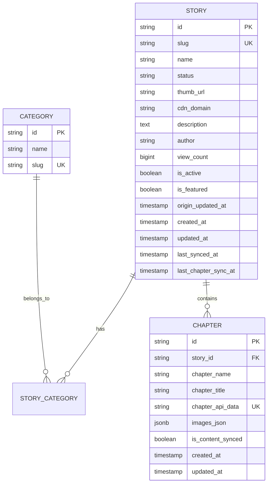

# Feature: Thiết lập Database Schema & Entities

- **Mã tính năng:** `F-01 / DB-CORE`
- **Trạng thái:** Hoàn thành
- **Ngày hoàn thành:** 2026-03-25
- **Tác giả / Phụ trách:** Backend Team
- **Nhánh Git:** `develop`

---

## 1. Tổng quan & Mục tiêu

- **Mục đích:** Xây dựng cấu trúc lưu trữ cơ sở dữ liệu trên PostgreSQL để hỗ trợ hệ thống Webtoon Aggregator: quản lý truyện (`story`), thể loại (`category`), danh sách chương (`chapter`) với mảng ảnh lưu trữ dạng `JSONB`.
- **Điểm nổi bật:**
  - Tối ưu hóa đọc dữ liệu chương qua kiểu dữ liệu PostgreSQL `JSONB` (`images_json`), tránh tạo hàng triệu row rời rạc cho từng ảnh.
  - Sử dụng Hibernate 6 `@JdbcTypeCode(SqlTypes.JSON)` trên Spring Boot 3.
  - Indexing tối ưu cho việc tìm kiếm theo `slug`, thời gian cập nhật `updated_at`, và trạng thái kích hoạt `is_active`.

---

## 2. Kiến trúc & Quan hệ dữ liệu (ER Diagram)

---

## 3. Các file mã nguồn chính

- **Entities:**
  - `src/main/java/com/struyen/struyen/entities/Story.java`
  - `src/main/java/com/struyen/struyen/entities/Category.java`
  - `src/main/java/com/struyen/struyen/entities/Chapter.java`
- **Repositories:**
  - `src/main/java/com/struyen/struyen/repositories/StoryRepository.java`
  - `src/main/java/com/struyen/struyen/repositories/CategoryRepository.java`
  - `src/main/java/com/struyen/struyen/repositories/ChapterRepository.java`
- **Database DDL Reference:**
  - `docs/database/schema.sql`

---

## 4. Xác minh & Kiểm thử

- Chạy `.\mvnw.cmd compile` đảm bảo các Entity JPA và quan hệ mapping hợp lệ.
- Kiểm tra cấu hình kết nối database trong `src/main/resources/application.properties` với PostgreSQL.

