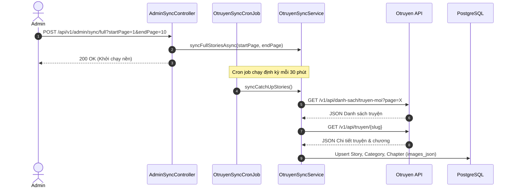

# Feature: Otruyen Data Sync & Cron Job

- **Mã tính năng:** `F-02 / SYNC-OTRUYEN`
- **Trạng thái:** Hoàn thành
- **Ngày hoàn thành:** 2026-03-26
- **Tác giả / Phụ trách:** Backend Team
- **Nhánh Git:** `develop`

---

## 1. Tổng quan & Mục tiêu

- **Mục đích:** Tự động hóa và quản lý việc cào / đồng bộ dữ liệu truyện tranh từ Otruyen API (`https://otruyenapi.com`), bao gồm danh mục thể loại, danh sách truyện mới, chi tiết nội dung truyện và danh sách chương.
- **Tính năng chính:**
  - **Catch-up Sync (`syncCatchUpStories`)**: Thuật toán so sánh mốc thời gian cập nhật `origin_updated_at` để chỉ tải các truyện có sự thay đổi mới, tiết kiệm băng thông và tối ưu hiệu suất.
  - **Async Full Sync (`syncFullStoriesAsync`)**: Chạy ngầm trong background task qua `ThreadPoolTaskExecutor` (2-5 threads) cào nhiều trang mà không làm nghẽn HTTP request hay tràn tài nguyên.
  - **Tối ưu Transaction & Chống cạn kiệt Connection Pool**: Tách toàn bộ tác vụ mạng và sleep ra ngoài `@Transactional`, chỉ mở transaction ngắn khi thực hiện ghi dữ liệu.
  - **Loại bỏ N+1 Query**: Lấy danh sách tên chapter hiện có trong 1 query duy nhất `findChapterNamesByStoryId` để so khớp $O(1)$ trong RAM.
  - **Bảo vệ API Admin Sync**: Yêu cầu Header `X-Admin-Key` để ngăn chặn kích hoạt bất hợp pháp từ ngoài internet.
  - **Cron Job (`OtruyenSyncCronJob`)**: Tự động thực thi định kỳ mỗi 30 phút (`${sync.otruyen.fixed-delay:1800000}`).

  - **Upsert Logic**: Đảm bảo không trùng lặp dữ liệu `Story`, `Category`, `Chapter` khi đồng bộ lại nhiều lần.

---

## 2. Kiến trúc & Luồng xử lý



---

## 3. Các file mã nguồn chính

- **Controllers:**
  - `src/main/java/com/struyen/struyen/controllers/AdminSyncController.java`
- **Services:**
  - `src/main/java/com/struyen/struyen/services/OtruyenSyncService.java`
- **Cron Jobs:**
  - `src/main/java/com/struyen/struyen/cronjobs/OtruyenSyncCronJob.java`
- **DTOs:**
  - `src/main/java/com/struyen/struyen/dtos/OtruyenDto.java`

---

## 4. Danh sách API Endpoints

### 4.1 Kích hoạt đồng bộ Full Data ngầm (Admin)
- **Method:** `POST`
- **URL:** `/api/v1/admin/sync/full`
- **Headers:** `X-Admin-Key: admin-struyen-secret-key-2026` (bắt buộc)
- **Params:**
  - `startPage` (int, default = 1): Trang bắt đầu
  - `endPage` (int, default = 10): Trang kết thúc
- **Response (200 OK):**
```text
Tiến trình cào Full Data từ trang 1 đến trang 10 đã được khởi chạy ngầm (Background Task). Vui lòng theo dõi tiến độ trên màn hình Console Logs nhé!
```
- **Response (401 Unauthorized):** Nếu thiếu hoặc sai Header `X-Admin-Key`.


---

## 5. Hướng dẫn kiểm thử

- **Test qua cURL:**
  ```bash
  curl -X POST "http://localhost:8080/api/v1/admin/sync/full?startPage=1&endPage=1"
  ```
- **Kiểm tra Logs:** Xem terminal để theo dõi log quá trình upsert truyện và chương vào PostgreSQL.

