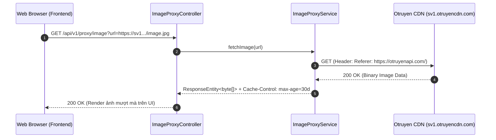

# Feature: Image Proxy Service (Bypass Hotlink Protection)

- **Mã tính năng:** `F-03 / IMAGE-PROXY`
- **Trạng thái:** Hoàn thành
- **Ngày hoàn thành:** 2026-03-25
- **Tác giả / Phụ trách:** Backend Team
- **Nhánh Git:** `develop`

---

## 1. Tổng quan & Mục tiêu

- **Mục đích:** Otruyen CDN áp dụng cơ chế Hotlink Protection (chặn hiển thị ảnh nếu request không đến từ domain được phép hoặc thiếu Referer hợp lệ). Tính năng Image Proxy đóng vai trò trạm trung chuyển (Reverse Proxy) tải ảnh từ Otruyen CDN về và phân phối lại cho frontend client.
- **Tính năng chính:**
  - **Bảo mật SSRF (Whitelisting):** Chỉ cho phép proxy từ các domain CDN hợp lệ của Otruyen (`*.otruyencdn.com`, `*.otruyenapi.com`), chặn đứng nguy cơ tấn công mạng nội bộ và Cloud metadata.
  - **Bảo vệ RAM JVM (Anti-OOM):** Giới hạn dung lượng tải ảnh tối đa 15MB, ngăn chặn tràn bộ nhớ Heap.
  - Gắn header `Referer: https://otruyenapi.com/` và `User-Agent` chuẩn trình duyệt để vượt qua rào cản 403 Forbidden.
  - Tự động phát hiện và giữ nguyên `Content-Type` của ảnh gốc (JPEG, PNG, WebP,...).
  - Tích hợp `Cache-Control: public, max-age=2592000` (30 ngày) để trình duyệt người dùng cache cục bộ, giảm tải tối đa cho máy chủ proxy.


---

## 2. Kiến trúc & Luồng xử lý



---

## 3. Các file mã nguồn chính

- **Controller:**
  - `src/main/java/com/struyen/struyen/controllers/ImageProxyController.java`
- **Service:**
  - `src/main/java/com/struyen/struyen/services/ImageProxyService.java`
- **Unit Tests:**
  - `src/test/java/com/struyen/struyen/services/ImageProxyServiceTest.java`
- **Config:**
  - `src/main/java/com/struyen/struyen/config/RestTemplateConfig.java`

---

## 4. Danh sách API Endpoints

### 4.1 Proxy hình ảnh
- **Method:** `GET`
- **URL:** `/api/v1/proxy/image`
- **Query Params:**
  - `url` (String, bat buoc): Duong dan truc tiep hoac ten file tuong doi tren Otruyen CDN
- **Dac tinh bo sung:**
  - **Auto Normalization:** Tu dong chuyen doi ten file tuong doi (vi du: `truyen-thumb.jpg`) sang URL CDN day du (`https://img.otruyenapi.com/uploads/comics/...`).
  - **Fallback Placeholder:** Khi CDN upstream loi 404, 502 hoac timeout, tra ve inline SVG placeholder kem HTTP 200 de tranh vo giao dien nguoi dung.
- **Response Headers:**
  - `Content-Type: image/jpeg` (hoac `image/svg+xml` khi fallback)
  - `Cache-Control: public, max-age=2592000` (hoac `max-age=300` khi fallback)
- **Response Body:** Binary byte stream cua file anh

---

## 5. Hướng dẫn kiểm thử

- **Test qua cURL:**
  ```bash
  curl -I "http://localhost:8080/api/v1/proxy/image?url=https://sv1.otruyencdn.com/v1/api/chapter/xxx/001.jpg"
  ```
- **Test fallback khi CDN khong truy cap duoc:**
  ```bash
  curl -i "http://localhost:8080/api/v1/proxy/image?url=invalid-file.jpg"
  ```
- **Kiem tra Unit Test:**
  ```bash
  ./mvnw test -Dtest=ImageProxyServiceTest
  ```

