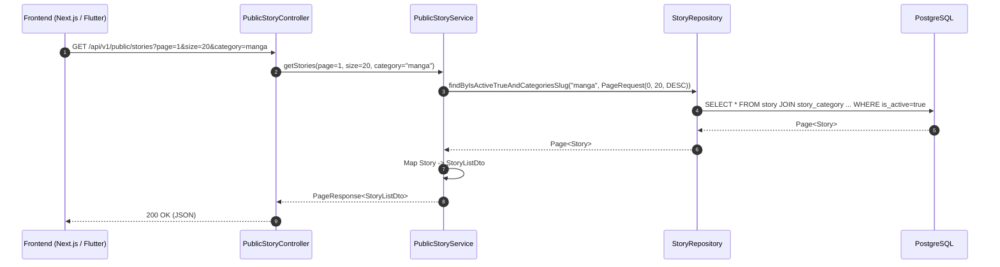

# Feature: Public Story Listing & Filter API

- **Mã tính năng:** `F-04 / PUBLIC-STORY-API`
- **Trạng thái:** Hoàn thành
- **Ngày hoàn thành:** 2026-05-06
- **Tác giả / Phụ trách:** Backend Team
- **Nhánh Git:** `develop`

---

## 1. Tổng quan & Mục tiêu

- **Mục đích:** Cung cấp API công khai cho người dùng đọc truyện (Client Web/App) để lấy danh sách truyện tranh mới cập nhật, hỗ trợ phân trang (Pagination 1-indexed) và lọc theo thể loại (`categorySlug`).
- **Tính năng chính:**
  - Chỉ trả về các truyện đang hoạt động (`isActive = true`).
  - Sắp xếp mặc định theo thời gian cập nhật mới nhất (`updatedAt DESC`).
  - Chuyển đổi an toàn từ Entity sang `StoryListDto` gọn nhẹ, không làm lộ trường nhạy cảm hay gây lỗi Lazy Loading Hibernate.
  - Định dạng chuẩn phân trang `PageResponse<T>` gồm số trang hiện tại, tổng số trang, tổng số bản ghi và cờ đánh dấu trang cuối.

---

## 2. Kiến trúc & Luồng xử lý



---

## 3. Các file mã nguồn chính

- **Controller:**
  - `src/main/java/com/struyen/struyen/controllers/PublicStoryController.java`
- **Service:**
  - `src/main/java/com/struyen/struyen/services/PublicStoryService.java`
- **Repository:**
  - `src/main/java/com/struyen/struyen/repositories/StoryRepository.java`
- **DTOs:**
  - `src/main/java/com/struyen/struyen/dtos/PageResponse.java`
  - `src/main/java/com/struyen/struyen/dtos/StoryListDto.java`

---

## 4. Danh sách API Endpoints

### 4.1 Lấy danh sách truyện công khai
- **Method:** `GET`
- **URL:** `/api/v1/public/stories`
- **Query Params:**
  - `page` (int, default = 1): Số trang (Client truyền từ 1)
  - `size` (int, default = 10): Số phần tử trên mỗi trang
  - `category` (string, optional): Slug của thể loại cần lọc (ví dụ: `action`, `manhwa`)
- **Response mẫu (200 OK):**
```json
{
  "content": [
    {
      "id": "64bc123...",
      "name": "Solo Leveling",
      "slug": "solo-leveling",
      "thumbUrl": "https://...",
      "cdnDomain": "https://sv1.otruyencdn.com",
      "status": "ongoing",
      "author": "Chugong",
      "updatedAt": "2026-05-06T06:00:00",
      "categories": ["Action", "Fantasy", "Manhwa"]
    }
  ],
  "page": 1,
  "size": 10,
  "totalElements": 1500,
  "totalPages": 150,
  "last": false
}
```

---

## 5. Hướng dẫn kiểm thử

- **Test cURL:**
  ```bash
  curl "http://localhost:8080/api/v1/public/stories?page=1&size=10"
  ```
- **Test lọc theo thể loại:**
  ```bash
  curl "http://localhost:8080/api/v1/public/stories?category=action"
  ```

