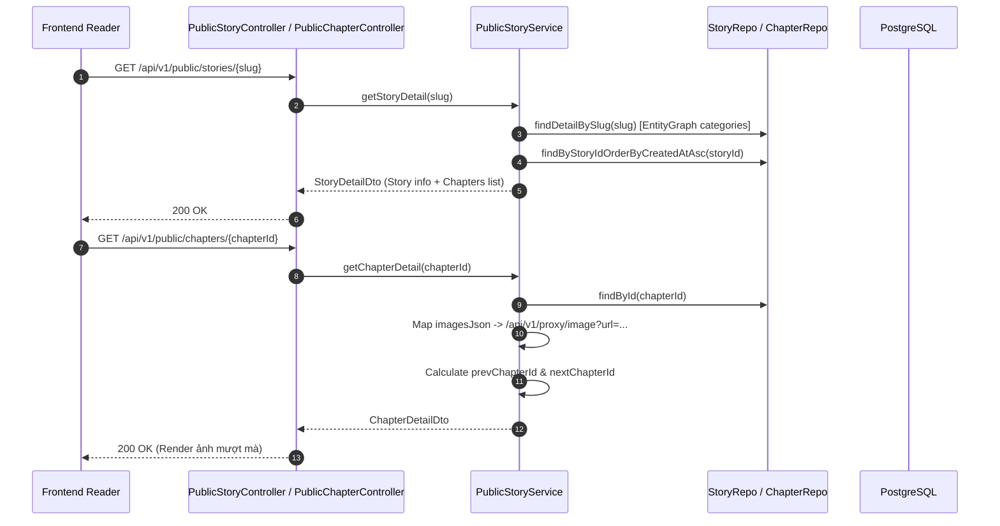

# Feature: Story Detail & Chapter Reader API

- **Mã tính năng:** `F-06 / STORY-DETAIL-READER`
- **Trạng thái:** Hoàn thành
- **Ngày hoàn thành:** 2026-11-09
- **Tác giả / Phụ trách:** Backend Team
- **Nhánh Git:** `develop`

---

## 1. Tổng quan & Mục tiêu

- **Mục đích:** Cung cấp 2 API then chốt để hoàn thiện trải nghiệm đọc truyện (Reader flow) cho người dùng cuối trên Frontend Web/App:
  1. **Chi tiết truyện (`GET /api/v1/public/stories/{slug}`)**: Trả về thông tin đầy đủ của bộ truyện kèm danh sách tất cả các chương theo thứ tự tạo.
  2. **Đọc nội dung chương (`GET /api/v1/public/chapters/{chapterId}`)**: Trả về danh sách URL ảnh đã tự động qua bọc Image Proxy (`/api/v1/proxy/image?url=...`), đồng thời tính toán liên kết chương trước (`prevChapterId`) và chương sau (`nextChapterId`) để người dùng chuyển tập nhanh.

---

## 2. Kiến trúc & Luồng xử lý



---

## 3. Các file mã nguồn chính

- **Controllers:**
  - `src/main/java/com/struyen/struyen/controllers/PublicStoryController.java`
  - `src/main/java/com/struyen/struyen/controllers/PublicChapterController.java`
- **Service:**
  - `src/main/java/com/struyen/struyen/services/PublicStoryService.java`
- **Repositories:**
  - `src/main/java/com/struyen/struyen/repositories/StoryRepository.java`
  - `src/main/java/com/struyen/struyen/repositories/ChapterRepository.java`
- **DTOs:**
  - `src/main/java/com/struyen/struyen/dtos/StoryDetailDto.java`
  - `src/main/java/com/struyen/struyen/dtos/ChapterShortDto.java`
  - `src/main/java/com/struyen/struyen/dtos/ChapterDetailDto.java`

---

## 4. Danh sách API Endpoints

### 4.1 Chi tiết truyện theo slug
- **Method:** `GET`
- **URL:** `/api/v1/public/stories/{slug}`
- **Response mẫu (200 OK):**
```json
{
  "id": "64bc123...",
  "name": "Solo Leveling",
  "slug": "solo-leveling",
  "thumbUrl": "https://...",
  "cdnDomain": "https://sv1.otruyencdn.com",
  "status": "ongoing",
  "author": "Chugong",
  "description": "<p>Nội dung truyện...</p>",
  "viewCount": 0,
  "isFeatured": false,
  "updatedAt": "2026-05-06T06:00:00",
  "categories": [
    { "id": "cat-01", "name": "Action", "slug": "action" }
  ],
  "chapters": [
    { "id": "chap-01", "chapterName": "1", "chapterTitle": "Mở đầu", "updatedAt": "2026-05-06T06:00:00" },
    { "id": "chap-02", "chapterName": "2", "chapterTitle": "Thức tỉnh", "updatedAt": "2026-05-06T06:00:00" }
  ]
}
```

### 4.2 Chi tiết nội dung chương (Đọc truyện)
- **Method:** `GET`
- **URL:** `/api/v1/public/chapters/{chapterId}`
- **Response mẫu (200 OK):**
```json
{
  "chapterId": "chap-02",
  "storyId": "64bc123...",
  "storySlug": "solo-leveling",
  "storyName": "Solo Leveling",
  "chapterName": "2",
  "chapterTitle": "Thức tỉnh",
  "prevChapterId": "chap-01",
  "nextChapterId": "chap-03",
  "images": [
    "/api/v1/proxy/image?url=https%3A%2F%2Fsv1.otruyencdn.com%2F...%2F001.jpg",
    "/api/v1/proxy/image?url=https%3A%2F%2Fsv1.otruyencdn.com%2F...%2F002.jpg"
  ]
}
```

---

## 5. Hướng dẫn kiểm thử (curl)

```bash
# Xem chi tiết truyện
curl "http://localhost:8080/api/v1/public/stories/solo-leveling"

# Đọc nội dung chương
curl "http://localhost:8080/api/v1/public/chapters/650abcd123"
```

