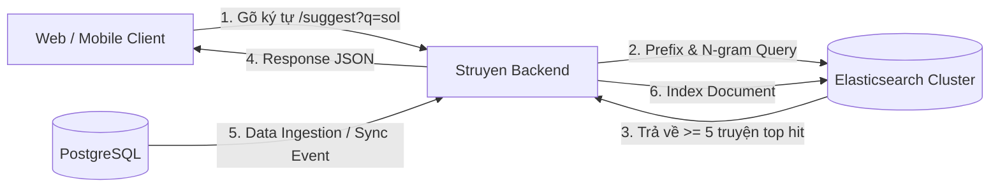

# Feature Planning: Elasticsearch Full-Text Search & Smart Suggestions

- **Mã tính năng:** `F-08 / ELASTICSEARCH-SEARCH-SUGGESTION`
- **Trạng thái:** Dự thảo / Planning
- **Độ ưu tiên:** Cao (High)
- **Người phụ trách:** Backend Team & Search Architect
- **Dự kiến triển khai:** Phase 2.5 / Phase 3

---

## 1. Tổng quan & Mục tiêu

- **Mục đích:** Xây dựng hệ thống tìm kiếm truyện siêu tốc với Elasticsearch (thay thế Full-text search trên PostgreSQL để đạt độ trễ < 20ms).
- **Yêu cầu cốt lõi:**
  1. **Tìm kiếm tức thì (Instant Search):** Tìm kiếm theo tên truyện (tiếng Việt có dấu và không dấu), slug, tác giả, và thể loại.
  2. **Gợi ý tự động (Auto-suggestion):** Khi người dùng gõ từ khóa vào thanh tìm kiếm, hệ thống phải trả về **ít nhất 5 truyện gợi ý phù hợp nhất** (kèm ảnh thumbnail, tên truyện, tác giả, số chương mới nhất).
  3. **Độ chịu lỗi chính tả (Fuzzy Search):** Hỗ trợ tìm kiếm gần đúng khi người dùng gõ sai 1-2 ký tự (ví dụ: `soloo levelng` -> `Solo Leveling`).

---

## 2. Kiến trúc & Thiết kế kỹ thuật



---

## 3. Thiết kế Index & Analyzer (Elasticsearch)

### 3.1 Cấu trúc Document `story_index`
```json
{
  "mappings": {
    "properties": {
      "id": { "type": "keyword" },
      "slug": { "type": "keyword" },
      "name": { 
        "type": "text", 
        "analyzer": "vi_analyzer",
        "fields": {
          "suggest": {
            "type": "completion",
            "analyzer": "standard"
          },
          "keyword": { "type": "keyword" }
        }
      },
      "author": { "type": "text", "analyzer": "vi_analyzer" },
      "thumbUrl": { "type": "keyword", "index": false },
      "status": { "type": "keyword" },
      "categories": { "type": "keyword" },
      "viewCount": { "type": "long" },
      "updatedAt": { "type": "date" }
    }
  }
}
```

---

## 4. Danh sách API Endpoints dự kiến

### 4.1 Gợi ý nhanh khi người dùng đang gõ (Search Suggestion)
- **Method:** `GET`
- **URL:** `/api/v1/public/search/suggestions`
- **Query Params:**
  - `keyword` (string, bắt buộc): Chuỗi ký tự người dùng vừa gõ (ví dụ: `sol`)
  - `limit` (int, default = 5, tối thiểu 5): Số lượng truyện gợi ý
- **Response mẫu (200 OK):**
```json
{
  "keyword": "sol",
  "totalSuggestions": 5,
  "suggestions": [
    {
      "id": "story-01",
      "name": "Solo Leveling",
      "slug": "solo-leveling",
      "thumbUrl": "https://...",
      "author": "Chugong",
      "status": "completed",
      "latestChapter": "Chapter 200"
    },
    {
      "id": "story-02",
      "name": "Solo Bug Player",
      "slug": "solo-bug-player",
      "thumbUrl": "https://...",
      "author": "Cheongcho",
      "status": "ongoing",
      "latestChapter": "Chapter 85"
    }
  ]
}
```

### 4.2 Tìm kiếm đầy đủ (Full Search với Pagination)
- **Method:** `GET`
- **URL:** `/api/v1/public/search`
- **Params:** `q`, `page`, `size`, `category`, `status`, `sort`

---

## 5. Chiến lược đồng bộ dữ liệu (PostgreSQL -> Elasticsearch)
- **Cách 1 (Spring Application Events):** Mỗi khi `OtruyenSyncService` hoàn tất upsert một Story, phát ra một `StoryUpsertedEvent` để `ElasticsearchSyncListener` đẩy document lên Elasticsearch.
- **Cách 2 (Batch Cron Re-index):** Chạy cron job định kỳ kiểm tra `updated_at` để bù các bản ghi bị lệch.

