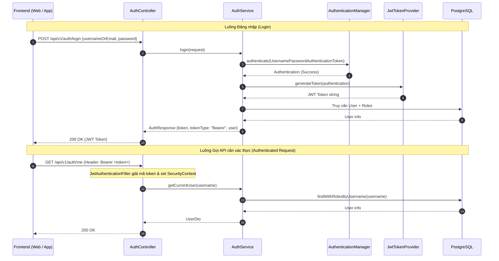

# Feature: User Authentication & Authorization with JWT

- **Mã tính năng:** `F-09 / USER-AUTH-JWT`
- **Trạng thái:** Hoàn thành
- **Ngày hoàn thành:** 2026-11-09
- **Tác giả / Phụ trách:** Backend Team
- **Nhánh Git:** `develop`

---

## 1. Tổng quan & Mục tiêu

- **Mục đích:** Xây dựng hệ thống định danh, xác thực và phân quyền người dùng bảo mật chuẩn Stateless REST API sử dụng Spring Security 6 và JSON Web Token (JJWT 0.12.x).
- **Tính năng chính:**
  - **Đăng ký tài khoản (`/api/v1/auth/register`)**: Kiểm tra trùng lặp `username` và `email`, băm mật khẩu an toàn với thuật toán `BCryptPasswordEncoder`, tự động gán quyền mặc định `ROLE_MEMBER`.
  - **Đăng nhập (`/api/v1/auth/login`)**: Hỗ trợ đăng nhập linh hoạt bằng `username` hoặc `email`. Kiểm tra trạng thái tài khoản (`ACTIVE` / `BANNED`), sinh chuỗi JWT Token có thời hạn (24h).
  - **Lấy thông tin cá nhân (`/api/v1/auth/me`)**: Trích xuất `username` từ Header `Authorization: Bearer <token>` để trả về thông tin người dùng đang đăng nhập.
  - **JwtAuthenticationFilter**: Bộ lọc bảo mật chặn mọi request, giải mã token và đưa `UserDetails` vào `SecurityContextHolder`.
  - **DataInitializer**: Tự động khởi tạo 2 Role hệ thống mặc định (`ROLE_MEMBER` và `ROLE_ADMIN`) khi khởi chạy ứng dụng lần đầu.

---

## 2. Kiến trúc & Luồng xác thực (Authentication Sequence)



---

## 3. Các file mã nguồn chính

- **Entities & Repositories:**
  - `src/main/java/com/struyen/struyen/entities/User.java`
  - `src/main/java/com/struyen/struyen/entities/Role.java`
  - `src/main/java/com/struyen/struyen/repositories/UserRepository.java`
  - `src/main/java/com/struyen/struyen/repositories/RoleRepository.java`
- **Security & JWT:**
  - `src/main/java/com/struyen/struyen/security/JwtTokenProvider.java`
  - `src/main/java/com/struyen/struyen/security/JwtAuthenticationFilter.java`
  - `src/main/java/com/struyen/struyen/security/CustomUserDetails.java`
  - `src/main/java/com/struyen/struyen/security/CustomUserDetailsService.java`
  - `src/main/java/com/struyen/struyen/config/SecurityConfig.java`
  - `src/main/java/com/struyen/struyen/config/DataInitializer.java`
- **Service & Controller:**
  - `src/main/java/com/struyen/struyen/services/AuthService.java`
  - `src/main/java/com/struyen/struyen/controllers/AuthController.java`
- **DTOs:**
  - `src/main/java/com/struyen/struyen/dtos/RegisterRequest.java`
  - `src/main/java/com/struyen/struyen/dtos/LoginRequest.java`
  - `src/main/java/com/struyen/struyen/dtos/AuthResponse.java`
  - `src/main/java/com/struyen/struyen/dtos/UserDto.java`

---

## 4. Danh sách API Endpoints

### 4.1 Đăng ký tài khoản
- **Method:** `POST`
- **URL:** `/api/v1/auth/register`
- **Request Body:**
```json
{
  "username": "reader01",
  "email": "reader01@gmail.com",
  "password": "Password123"
}
```
- **Response (201 Created):**
```json
{
  "token": "eyJhbGciOiJIUzI1NiIsInR5cCI6IkpXVCJ9...",
  "tokenType": "Bearer",
  "user": {
    "id": 1,
    "username": "reader01",
    "email": "reader01@gmail.com",
    "avatarUrl": null,
    "userStatus": "ACTIVE",
    "roles": ["ROLE_MEMBER"],
    "createdAt": "2026-11-09T09:00:00"
  }
}
```

### 4.2 Đăng nhập
- **Method:** `POST`
- **URL:** `/api/v1/auth/login`
- **Request Body:**
```json
{
  "usernameOrEmail": "reader01",
  "password": "Password123"
}
```
- **Response (200 OK):**
```json
{
  "token": "eyJhbGciOiJIUzI1NiIsInR5cCI6IkpXVCJ9...",
  "tokenType": "Bearer",
  "user": {
    "id": 1,
    "username": "reader01",
    "email": "reader01@gmail.com",
    "avatarUrl": null,
    "userStatus": "ACTIVE",
    "roles": ["ROLE_MEMBER"],
    "createdAt": "2026-11-09T09:00:00"
  }
}
```

### 4.3 Xem hồ sơ người dùng đang đăng nhập
- **Method:** `GET`
- **URL:** `/api/v1/auth/me`
- **Headers:** `Authorization: Bearer <token>`
- **Response (200 OK):** Trả về `UserDto`.

---

## 5. Hướng dẫn kiểm thử (curl)

```bash
# 1. Đăng ký tài khoản mới
curl -X POST "http://localhost:8080/api/v1/auth/register" \
  -H "Content-Type: application/json" \
  -d '{"username": "testuser", "email": "test@gmail.com", "password": "password123"}'

# 2. Đăng nhập để lấy Token
curl -X POST "http://localhost:8080/api/v1/auth/login" \
  -H "Content-Type: application/json" \
  -d '{"usernameOrEmail": "testuser", "password": "password123"}'

# 3. Lấy thông tin cá nhân với Token
curl -X GET "http://localhost:8080/api/v1/auth/me" \
  -H "Authorization: Bearer <TOKEN_O_BUOC_2>"
```

