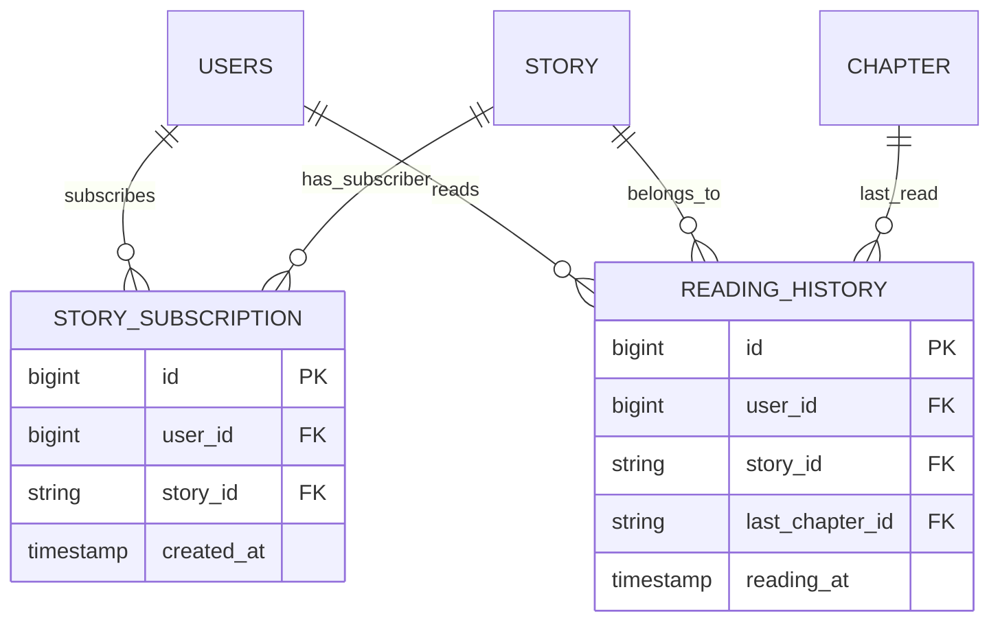

# Feature: Personal Library (Story Subscription & Reading History)

- **Mã tính năng:** `F-10 / PERSONAL-LIBRARY`
- **Trạng thái:** Hoàn thành
- **Ngày hoàn thành:** 2026-11-09
- **Tác giả / Phụ trách:** Backend Team
- **Nhánh Git:** `develop`

---

## 1. Tổng quan & Mục tiêu

- **Mục đích:** Cung cấp tính năng quản lý tủ truyện cá nhân gắn liền với tài khoản người dùng đã đăng nhập (JWT):
  1. **Theo dõi truyện (Story Subscription)**: Đánh dấu theo dõi truyện để lưu vào danh sách yêu thích và nhận thông báo khi có chương mới.
  2. **Lịch sử đọc truyện (Reading History)**: Tự động ghi nhớ chương truyện người dùng đang đọc dở và thời điểm đọc gần nhất, hỗ trợ đồng bộ trạng thái đọc trên nhiều thiết bị.

---

## 2. Kiến trúc & Thiết kế cơ sở dữ liệu



---

## 3. Các file mã nguồn chính

- **Entities & Repositories:**
  - `src/main/java/com/struyen/struyen/entities/StorySubscription.java`
  - `src/main/java/com/struyen/struyen/entities/ReadingHistory.java`
  - `src/main/java/com/struyen/struyen/repositories/StorySubscriptionRepository.java`
  - `src/main/java/com/struyen/struyen/repositories/ReadingHistoryRepository.java`
- **Service & Controller:**
  - `src/main/java/com/struyen/struyen/services/UserLibraryService.java`
  - `src/main/java/com/struyen/struyen/controllers/UserLibraryController.java`
- **DTOs:**
  - `src/main/java/com/struyen/struyen/dtos/SubscriptionDto.java`
  - `src/main/java/com/struyen/struyen/dtos/ReadingHistoryDto.java`
  - `src/main/java/com/struyen/struyen/dtos/RecordHistoryRequest.java`

---

## 4. Danh sách API Endpoints (Yêu cầu JWT Token)

Tất cả các API này đều yêu cầu header `Authorization: Bearer <token>`.

### 4.1 Theo dõi truyện
- **Theo dõi một truyện:** `POST /api/v1/me/library/subscriptions/{storyId}`
- **Hủy theo dõi:** `DELETE /api/v1/me/library/subscriptions/{storyId}`
- **Kiểm tra trạng thái theo dõi:** `GET /api/v1/me/library/subscriptions/status/{storyId}` -> `{"isSubscribed": true}`
- **Lấy danh sách truyện đang theo dõi:** `GET /api/v1/me/library/subscriptions?page=1&size=10`

### 4.2 Lịch sử đọc truyện
- **Lưu / Cập nhật tiến độ đọc:** `POST /api/v1/me/library/history`
  - Body: `{"storyId": "slug-or-id", "chapterId": "chap-id"}`
- **Lấy danh sách lịch sử đọc:** `GET /api/v1/me/library/history?page=1&size=10`
- **Xóa một mục khỏi lịch sử:** `DELETE /api/v1/me/library/history/{storyId}`

---

## 5. Hướng dẫn kiểm thử (curl)

```bash
# 1. Theo dõi truyện
curl -X POST "http://localhost:8080/api/v1/me/library/subscriptions/solo-leveling" \
  -H "Authorization: Bearer <TOKEN>"

# 2. Lưu lịch sử đọc
curl -X POST "http://localhost:8080/api/v1/me/library/history" \
  -H "Authorization: Bearer <TOKEN>" \
  -H "Content-Type: application/json" \
  -d '{"storyId": "solo-leveling", "chapterId": "chap-10"}'

# 3. Lấy lịch sử đọc
curl -X GET "http://localhost:8080/api/v1/me/library/history" \
  -H "Authorization: Bearer <TOKEN>"
```

