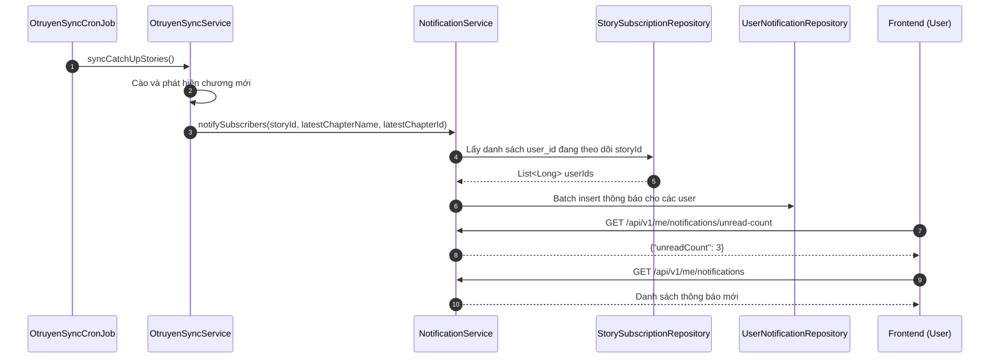

# Feature Planning: Automated User Notification System

- **Mã tính năng:** `F-12 / NOTIFICATION-SYSTEM`
- **Trạng thái:** Dự thảo / Planning
- **Độ ưu tiên:** Cao (High)
- **Người phụ trách:** Backend Team
- **Dự kiến triển khai:** Phase 3.2

---

## 1. Tổng quan & Mục tiêu

- **Mục đích:** Tự động tạo và gửi thông báo trong ứng dụng (In-app Notification) cho độc giả khi bộ truyện họ đang bấm Theo dõi (`story_subscription`) có chương mới được cập nhật từ Otruyen API.
- **Yêu cầu cốt lõi:**
  1. **Tự động kích hoạt (Event-driven / Hook):** Khi tiến trình `OtruyenSyncService` hoàn tất thêm các chương mới vào database, hệ thống tự động tìm danh sách tất cả `user_id` đang theo dõi truyện đó và tạo bản ghi thông báo tương ứng.
  2. **Quản lý trạng thái đọc:** Hiển thị số lượng thông báo chưa đọc (Unread Count) để Frontend gắn huy hiệu (Badge) trên biểu tượng chuông thông báo.
  3. **Điều hướng nhanh:** Mỗi thông báo mang theo đường dẫn trực tiếp (`link_url`) tới chương mới nhất vừa phát hành.

---

## 2. Kiến trúc & Luồng xử lý



---

## 3. Thiết kế Cơ sở dữ liệu (PostgreSQL)

Sử dụng bảng `user_notification` đã được quy hoạch trong `docs/database/schema.sql`:

```sql
CREATE TABLE IF NOT EXISTS user_notification (
    id BIGSERIAL PRIMARY KEY,
    user_id BIGINT REFERENCES users(id) ON DELETE CASCADE,
    title VARCHAR(255),
    message TEXT,
    link_url VARCHAR(255),
    is_read BOOLEAN DEFAULT FALSE,
    created_at TIMESTAMP WITHOUT TIME ZONE DEFAULT CURRENT_TIMESTAMP
);
CREATE INDEX IF NOT EXISTS idx_user_notif_user ON user_notification (user_id, is_read);
```

---

## 4. Danh sách API Endpoints dự kiến (Yêu cầu JWT Token)

### 4.1 Lấy danh sách thông báo của tôi
- **Method:** `GET`
- **URL:** `/api/v1/me/notifications?page=1&size=10`
- **Response mẫu (200 OK):**
```json
{
  "items": [
    {
      "id": 101,
      "title": "Chương mới: Solo Leveling",
      "message": "Truyện Solo Leveling bạn đang theo dõi vừa có Chapter 201!",
      "linkUrl": "/stories/solo-leveling/chapters/chap-201",
      "isRead": false,
      "createdAt": "2026-11-09T09:30:00"
    }
  ],
  "pageNumber": 1,
  "pageSize": 10,
  "totalElements": 1,
  "totalPages": 1,
  "isLast": true
}
```

### 4.2 Lấy số lượng thông báo chưa đọc
- **Method:** `GET`
- **URL:** `/api/v1/me/notifications/unread-count`
- **Response mẫu (200 OK):**
```json
{
  "unreadCount": 3
}
```

### 4.3 Đánh dấu thông báo đã đọc
- **Một thông báo:** `PATCH /api/v1/me/notifications/{id}/read`
- **Tất cả thông báo:** `PATCH /api/v1/me/notifications/read-all`
