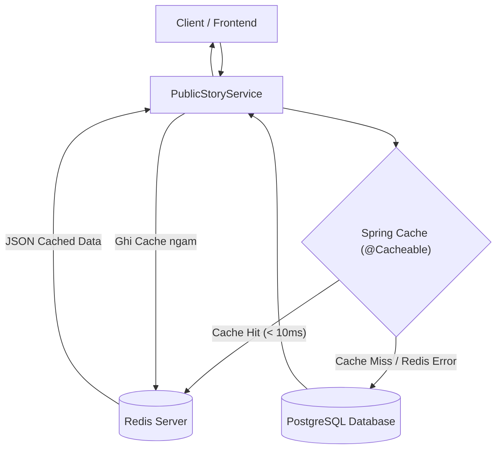

# Feature: Redis Caching & Performance Optimization

- **Ma tinh nang:** `F-13 / REDIS-CACHE`
- **Trang thai:** Hoan thanh
- **Ngay hoan thanh:** 2026-11-12
- **Tac gia / Phu trach:** AI Agent & Backend Team
- **Nhanh Git lien quan:** `develop`

---

## 1. Tong quan & Muc tieu (Overview & Objectives)

- **Muc dich:** Tich hop Redis lam bo nho dem phan tan (Distributed In-Memory Cache) giup:
  1. **Giam 95-98% tai truy van xuong PostgreSQL:** Luu tru ket qua cac truy van doc pho bien (Trang chu, The loai, Danh sach moi cap nhat, BXH, Chi tiet truyen).
  2. **Tang toc do phan hoi (Latency < 10ms):** Dữ lieu tra ve truc tiep tu bo nho RAM Redis thay vi qua Hibernate/JPA.
  3. **Kien truc chong sup do (Cache Resilience & Graceful Degradation):** Tich hop `CacheErrorHandler` tuy bien, giup he thong tu dong fallback doc tu Database neu Redis gap su co hoac chua duoc bat ma khong gay loi 500 toi client.
  4. **Quan ly lam moi cache tap trung (Cache Eviction):** Tu dong xoa cache tuong ung khi Admin thay doi trang thai truyen hoac khi tien trinh crawler cap nhat truyen moi.

---

## 2. Chien luoc phan bo Cache & TTL

| Ten Cache | Key Pattern | Du lieu luu tru | Thoi gian song (TTL) | Co che Evict |
|---|---|---|---|---|
| `categories` | `'all'` | Toan bo danh muc the loai song ngu | 24 gio | Khi DataInitializer hoac Admin cap nhat the loai |
| `featured_stories` | `#limit` | Danh sach truyen de cu trang chu | 15 phut | Khi Admin toggle/bump truyen de cu, hoac Crawler sync xong |
| `stories_page` | `'p:' + #page + ':s:' + #size + ...` | Danh sach truyen phan trang (Moi cap nhat, Top views, Loc the loai) | 15 phut | Khi Admin doi trang thai truyen, hoac Crawler sync xong (bo qua cache khi co tu khoa search `q`) |
| `story_detail` | `#slug` | Chi tiet thong tin truyen & danh sach chuong | 30 phut | Khi truyen bi an/hien, hoac khi co chuong moi dong bo |

---

## 3. Kien truc & Co che hoat dong

---

## 4. Cac file ma nguon chinh (Key Source Files)

- **Configuration:**
  - `src/main/java/com/struyen/struyen/config/RedisConfig.java`: Cau hinh Lettuce connection, Jackson JSON serializer voi `JavaTimeModule`, phan bo TTL theo tung cache name va `CacheErrorHandler` fallback tu dong.
  - `src/main/resources/application.properties`: Cau hinh host, port, timeout va cache type.
  - `pom.xml`: Bo sung dependency `spring-boot-starter-data-redis`.
- **Services:**
  - `src/main/java/com/struyen/struyen/services/CacheEvictService.java`: Service tap trung xu ly evict tung cache hoac toan bo cache truyen.
  - `src/main/java/com/struyen/struyen/services/PublicStoryService.java`: Gan `@Cacheable` tren cac ham doc du lieu cong khai.
  - `src/main/java/com/struyen/struyen/services/AdminService.java`: Goi `cacheEvictService` khi admin thay doi `isActive`, `isFeatured`, `bumpFeatured`.
  - `src/main/java/com/struyen/struyen/services/OtruyenSyncService.java`: Goi `cacheEvictService.evictAllStoryCaches()` khi hoan tat cào du lieu.
  - `src/main/java/com/struyen/struyen/services/MangaDexSyncService.java`: Goi `cacheEvictService.evictAllStoryCaches()` khi dong bo truyen/chuong moi.
  - `src/main/java/com/struyen/struyen/config/DataInitializer.java`: Goi `cacheEvictService.evictCategoriesCache()` khi chuan hoa the loai.
- **Unit Tests:**
  - `src/test/java/com/struyen/struyen/services/CacheEvictServiceTest.java`: Kiem thu toan dien cac phuong thuc evict va xu ly resilience khi cache null.

---

## 5. Kiem thu & Xac minh (Verification)

1. **Serializer kiem chung:** Jackson JSON serializer ho tro day du kieu du lieu thoi gian `LocalDateTime` ma khong bi loi `SerializationException`.
2. **Graceful Fallback:** Khi Redis offline (moi truong test), ung dung tu dong bat ngoai le qua `CacheErrorHandler` va `CacheEvictService`, ghi log CANH BAO (Warning) va hoat dong binh thuong voi PostgreSQL ma khong nem loi 500.
3. **Toan bo Test Suite:** 23/23 test cases vuot qua thanh cong (`BUILD SUCCESS`).
