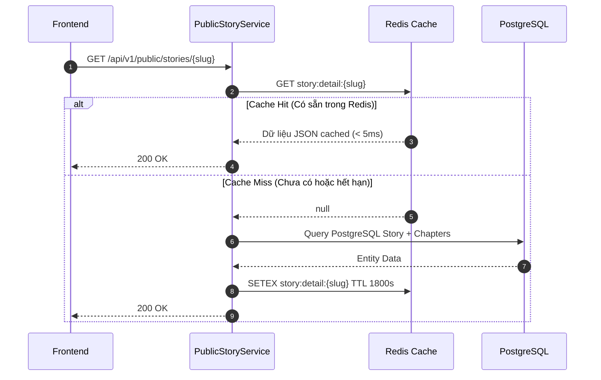

# Feature Planning: Redis Caching & Performance Optimization

- **Mã tính năng:** `F-13 / REDIS-CACHE`
- **Trạng thái:** Dự thảo / Planning
- **Độ ưu tiên:** Trung bình - Cao (Medium-High)
- **Người phụ trách:** Backend & DevOps Team
- **Dự kiến triển khai:** Phase 4.1

---

## 1. Tổng quan & Mục tiêu

- **Mục đích:** Tích hợp Redis vào tầng ứng dụng Spring Boot (`spring-boot-starter-data-redis`) làm bộ nhớ đệm phân tán (Distributed In-Memory Cache) để:
  1. **Giảm tải cho PostgreSQL:** Tránh việc hàng ngàn người dùng cùng query vào database cho các dữ liệu ít biến động.
  2. **Tăng tốc phản hồi (Latency < 10ms):** Tăng tốc độ load trang chủ, danh mục thể loại và chi tiết truyện lên gấp 5-10 lần.
  3. **Tự động làm mới cache (Cache Eviction):** Khi Cron Job hoặc Admin cập nhật truyện mới, hệ thống tự động xóa cache cũ để người dùng luôn nhận dữ liệu mới nhất.

---

## 2. Chiến lược phân bổ Cache (Cache Strategy & TTL)

| Tên Cache | Key Format | Dữ liệu lưu trữ | Thời gian sống (TTL) | Khi nào Evict? |
|---|---|---|---|---|
| `categories` | `categories:all` | Toàn bộ danh mục thể loại | 24 giờ | Khi thêm thể loại mới |
| `stories_page` | `stories:page:{page}:size:{size}:cat:{cat}` | Danh sách truyện trang chủ | 15 phút | Khi Cron sync xong batch truyện mới |
| `story_detail` | `story:detail:{slug}` | Chi tiết truyện & danh sách chương | 30 phút | Khi truyện đó có chương mới |

---

## 3. Kiến trúc & Cơ chế hoạt động



---

## 4. Các thư viện & Cấu hình cần bổ sung

### 4.1 Thư viện trong `pom.xml`:
```xml
<dependency>
    <groupId>org.springframework.boot</groupId>
    <artifactId>spring-boot-starter-data-redis</artifactId>
</dependency>
```

### 4.2 Cấu hình `application.properties`:
```properties
spring.data.redis.host=${REDIS_HOST:localhost}
spring.data.redis.port=${REDIS_PORT:6379}
spring.cache.type=redis
spring.cache.redis.time-to-live=1800000
```

