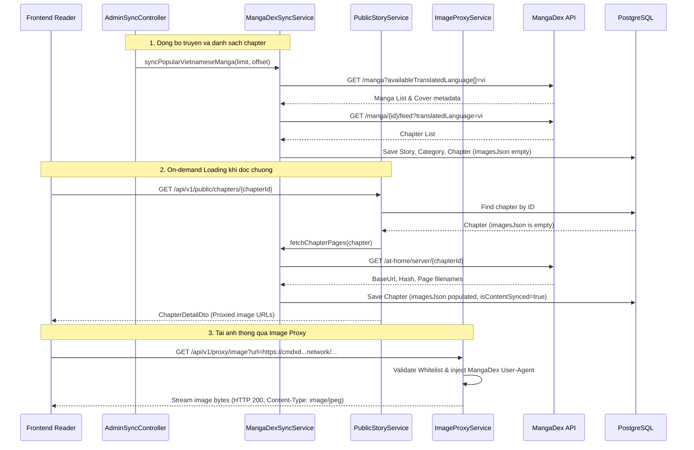

# Feature: Tich hop nguon truyen MangaDex API (Multi-Source Provider)

- **Ma tinh nang:** `F-15 / SYNC-MANGADEX`
- **Trang thai:** `Hoan thanh`
- **Ngay hoan thanh:** `2026-11-09`
- **Tac gia / Phu trach:** `AI Pair Programmer`
- **Nhanh Git lien quan:** `develop`

---

## 1. Tong quan & Muc tieu (Overview & Objectives)

- **Muc dich:** Bo sung nguon truyen tranh hop phap, on dinh va mien phi tu MangaDex API de giai quyet su co may chu Otruyen bi dung hoat dong.
- **Pham vi:**
  - Tich hop REST API MangaDex (`https://api.mangadex.org`) de crawl metadata truyen co ban dich Tieng Viet.
  - Co che Fallback Chuong Tieng Anh (English Chapter Fallback): Thu thap chuong Tieng Viet truoc, neu truyen khong co chuong Tieng Viet nao se tu dong fallback sang thu thap chuong Tieng Anh va gan co `hasVietnameseTranslation = false`. Neu ca Tieng Anh cung khong co chuong, tu dong huy bo luu truyen de tranh truyen rong (0 chapter).
  - Loai bo cac chuong Link ngoai (External Chapters: Webnovel, K Manga, MangaPlus...): Tham so `includeExternalUrl=0` va bo loc `externalUrl == null && pages > 0` dam bao 100% chapter duoc luu co anh tren CDN MangaDex, khong bao gio luu chapter 0 trang.
  - Tu dong quet don dep (cleanup) cac truyen va chuong link ngoai khong co anh luc khoi dong server.
  - Tu dong dich mo ta Tieng Anh sang Tieng Viet thong qua Google Translate API.
  - Viet hoa toan bo danh muc/the loai MangaDex (`VIETNAMESE_TAG_MAP`).
  - Pre-fetch tu dong 5 chuong dau tien vao PostgreSQL de nguoi doc mo truyen khong phai cho doi At-Home server.
  - Co che DNS Fallback (Custom DnsResolver) giai quyet triet de tinh trang ISP chan domain MangaDex.
  - Mo rong Image Proxy Service ho tro cac domain CDN cua MangaDex (`uploads.mangadex.org` va `*.mangadex.network`).
  - Thuc hien co che On-demand Chapter Loading cho cac chuong tiep theo khi nguoi dung doc.
  - Tuan thu Acceptable Use Policy cua MangaDex: su dung User-Agent dinh danh trung thuc va ap dung throttle <= 5 req/s.
- **Yeu cau ky thuat:** Spring Boot 3, Java 21, RestTemplate, PostgreSQL (JSONB cho chapter images), Mockito.

---

## 2. Thiet ke kien truc & Luong xu ly (Architecture & Workflow)



---

## 3. Thay doi Co so du lieu (Database Changes)

- **Thay doi Entity & Schema:**
  - `Story.language`: Ma ngon ngu cua bo truyen (`vi` hoac `en`, mac dinh `vi`).
  - `Story.hasVietnameseTranslation`: Boolean danh dau truyen da co ban dich Tieng Viet hay chua (mac dinh `true`, chuyen thanh `false` neu phai fallback sang Tieng Anh).
- Cac truong dinh danh va mapping du lieu:
  - `Story.id`: prefix `md-{mangaDexUuid}`.
  - `Story.cdnDomain`: `https://uploads.mangadex.org`.
  - `Chapter.id`: prefix `md-ch-{chapterUuid}`.
  - `Chapter.chapterApiData`: `https://api.mangadex.org/at-home/server/{chapterUuid}`.
  - `Chapter.imagesJson`: danh sach trang anh duoc luu dang jsonb.

---

## 4. Cac file ma nguon chinh (Key Source Files)

- **DTOs:**
  - `src/main/java/com/struyen/struyen/dtos/MangaDexDto.java`: Mapping JSON MangaDex API (`MangaListResponse`, `MangaData`, `ChapterListResponse`, `AtHomeResponse`).
- **Services:**
  - `src/main/java/com/struyen/struyen/services/MangaDexSyncService.java`: Logic dong bo metadata, chapters va at-home chapter pages.
  - `src/main/java/com/struyen/struyen/services/ImageProxyService.java`: Them whitelist `mangadex.org`, `mangadex.network` va User-Agent header.
  - `src/main/java/com/struyen/struyen/services/PublicStoryService.java`: Tich hop on-demand chapter loading khi nguoi dung mo chuong.
- **Controllers:**
  - `src/main/java/com/struyen/struyen/controllers/AdminSyncController.java`: Endpoints POST kich hoat dong bo MangaDex.
- **Tests:**
  - `src/test/java/com/struyen/struyen/services/MangaDexSyncServiceTest.java`: Unit tests kiem thu slug conversion, mapping story va on-demand loading.
  - `src/test/java/com/struyen/struyen/services/ImageProxyServiceTest.java`: Unit tests kiem thu whitelist MangaDex cover va chapter pages.

---

## 5. Danh sach API Endpoints

### 5.1 `POST /api/v1/admin/sync/mangadex/popular`
- **Mo ta:** Kich hoat dong bo danh sach truyen Tieng Viet pho bien nhat tu MangaDex (chay ngam bat dong bo).
- **Headers:** `X-Admin-Key: <adminSecretKey>`
- **Parameters:**
  - `limit`: So luong truyen can dong bo (mac dinh 10, toi da 50).
  - `offset`: Vi tri bat dau (mac dinh 0).
- **Response mau (200 OK):**
```text
Tien trinh dong bo 10 truyen Tieng Viet tu MangaDex (offset=0) da duoc khoi chay ngam.
```

### 5.2 `POST /api/v1/admin/sync/mangadex/manga/{mangaId}`
- **Mo ta:** Dong bo mot bo truyen cu the theo UUID MangaDex.
- **Headers:** `X-Admin-Key: <adminSecretKey>`
- **Response mau (200 OK):**
```text
Dong bo thanh cong truyen MangaDex id: a77742b1-befd-49a4-bff5-1ad4e6b0ef7b
```

### 5.3 `GET /api/v1/public/chapters/{chapterId}`
- **Mo ta:** Doc chi tiet chuong. Neu chuong thuoc MangaDex chua co anh, he thong tu dong goi MangaDex At-Home server de lay toan bo link anh va tra ve danh sach proxied image URLs.
- **Response mau (200 OK):**
```json
{
  "chapterId": "md-ch-7ffa6b78-6d0c-4f5e-b478-442aaa51c03f",
  "storyId": "md-a77742b1-befd-49a4-bff5-1ad4e6b0ef7b",
  "storySlug": "chainsaw-man",
  "storyName": "Chainsaw Man",
  "chapterName": "1",
  "chapterTitle": "[EiShun Team]",
  "prevChapterId": null,
  "nextChapterId": "md-ch-167b409c-542c-48cf-bb96-f3f3607a980e",
  "images": [
    "/api/v1/proxy/image?url=https%3A%2F%2Fcmdxd98sb0x3yprd.mangadex.network%2Fdata%2Fdd857de1e9f6b9b20d9b6ab1c6c6dae6%2F1-e6227f19e0b16d6727b255ee37016be567d618844cf92010fb3485fb949fee1d.jpg"
  ]
}
```

---

## 6. Huong dan kiem thu & Xac minh (Testing & Verification)

- **Chay Unit Tests:**
  ```bash
  ./mvnw test "-Dtest=ImageProxyServiceTest,MangaDexSyncServiceTest"
  ```
  Ket qua: 9 tests run, 0 failures, 0 errors, 0 skipped.

- **Curl test cào truyen:**
  ```bash
  curl -X POST -H "X-Admin-Key: admin-struyen-secret-key-2026" "http://localhost:8080/api/v1/admin/sync/mangadex/popular?limit=5&offset=0"
  ```

- **Curl test doc chuong on-demand:**
  ```bash
  curl -s "http://localhost:8080/api/v1/public/chapters/md-ch-7ffa6b78-6d0c-4f5e-b478-442aaa51c03f"
  ```

- **Curl test image proxy:**
  ```bash
  curl -I "http://localhost:8080/api/v1/proxy/image?url=https%3A%2F%2Fuploads.mangadex.org%2Fcovers%2Fa77742b1-befd-49a4-bff5-1ad4e6b0ef7b%2F6e518bd1-5f60-446b-8832-bfe6bf74834b.jpg.512.jpg"
  ```
  Ket qua: HTTP/1.1 200, Content-Type: image/jpeg.

