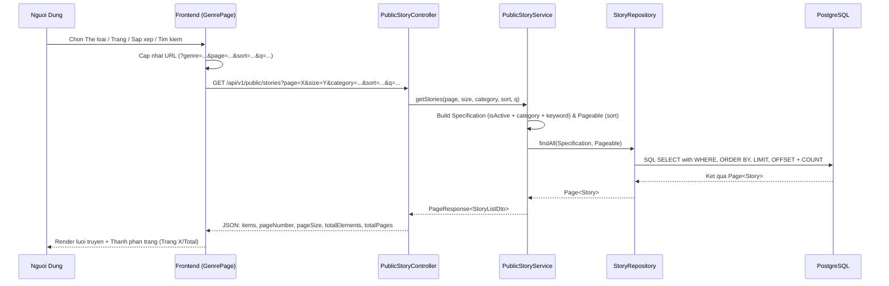

# Feature: Server-Side Dynamic Pagination, Filtering, Sorting and Search

- **Mã tính năng:** `F-17 / SERVER-SIDE-PAGINATION-FILTERING`
- **Trạng thái:** Hoàn thành
- **Ngày hoàn thành:** 2026-11-10
- **Tác giả / Phụ trách:** Antigravity AI Agent
- **Nhánh Git liên quan:** `develop`

---

## 1. Tổng quan & Mục tiêu (Overview & Objectives)

- **Mục đích:** Khắc phục triệt để vấn đề phân trang và lọc client-side trên browser (vốn chỉ lấy 50 truyện đầu tiên khiến người dùng không thể xem được các truyện từ thứ 51 trở đi, gây sai lệch sắp xếp và tìm kiếm). Chuyển đổi toàn diện sang kiến trúc phân trang, lọc theo thể loại, sắp xếp và tìm kiếm động trực tiếp trên Server-side thông qua Spring Data JPA Specifications và PostgreSQL.
- **Phạm vi:**
  - Backend: Cung cấp endpoint `/api/v1/public/stories` hỗ trợ đầy đủ `page`, `size`, `category`, `sort`, `q`.
  - Database: Tối ưu truy vấn động bằng JPA Specifications kết hợp `@BatchSize(size = 50)` trên relationship `categories` để loại bỏ N+1 và cảnh báo memory pagination của Hibernate.
  - Frontend: Tái cấu trúc trang Thể loại (`/genres`) và API Client để đồng bộ trạng thái 100% lên URL searchParams, hỗ trợ phân trang phân đoạn (Ellipsis Pagination), đổi chế độ xem grid/list, tìm kiếm và sắp xếp mượt mà.
- **Yêu cầu kỹ thuật:** Java 21, Spring Boot 3.5.x, Spring Data JPA Specifications, Next.js 15, TypeScript.

---

## 2. Thiết kế kiến trúc & Luồng xử lý (Architecture & Workflow)

---

## 3. Thay đổi Cơ sở dữ liệu (Database Changes)

- Không thay đổi bảng vật lý mới.
- Tối ưu hóa Entity `Story`: Thêm annotation `@org.hibernate.annotations.BatchSize(size = 50)` trên trường `categories` để tải trước danh mục theo mảng ID thay vì N+1 queries khi map sang DTO.

---

## 4. Các file mã nguồn chính (Key Source Files)

### Backend (`struyen_be`):
- **Entity:** `src/main/java/com/struyen/struyen/entities/Story.java`
- **Repository:** `src/main/java/com/struyen/struyen/repositories/StoryRepository.java` (Kế thừa `JpaSpecificationExecutor<Story>`)
- **Service:** `src/main/java/com/struyen/struyen/services/PublicStoryService.java` (Xây dựng Predicates động với JPA Specification)
- **Controller:** `src/main/java/com/struyen/struyen/controllers/PublicStoryController.java` (Nhận các query parameters: `page`, `size`, `category`, `sort`, `q`)

### Frontend (`komika-fe`):
- **API Endpoints:** `src/features/comics/api/comics.endpoints.ts`
- **API Client:** `src/features/comics/api/comics.api.ts` (Bổ sung `getComicsPaginated` nhận `sort` và `q`)
- **Route:** `src/app/genres/page.tsx` (Dynamic SSR Route hỗ trợ đọc searchParams)
- **Page Component:** `src/features/comics/pages/GenrePage.tsx` (Giao diện Server-driven với thanh phân trang thông minh)

---

## 5. Danh sách API Endpoints

| Phương thức | Đường dẫn URI | Tham số Query | Mô tả |
| :--- | :--- | :--- | :--- |
| `GET` | `/api/v1/public/stories` | `page` (int, default: 1) `size` (int, default: 12) `category` (string, optional) `sort` (string: newest, popular, a-z, rating) `q` (string, optional) | Lấy danh sách truyện có phân trang, lọc thể loại, sắp xếp và tìm kiếm động |

---

## 6. Kiểm thử & Xác minh (Verification)

1. **Phân trang:**
   - Gọi `GET /api/v1/public/stories?page=1&size=2`: Trả về đúng 2 truyện đầu tiên, `totalElements: 425`, `totalPages: 213`.
   - Gọi `GET /api/v1/public/stories?page=2&size=2`: Trả về 2 truyện tiếp theo khác biệt, `pageNumber: 2`.
2. **Lọc thể loại:**
   - Gọi `GET /api/v1/public/stories?category=romance&size=2`: Khớp 313 truyện thuộc thể loại Romance.
3. **Sắp xếp:**
   - Gọi `GET /api/v1/public/stories?sort=a-z&size=2`: Sắp xếp chính xác theo thứ tự chữ cái tên truyện.
4. **Tìm kiếm:**
   - Gọi `GET /api/v1/public/stories?q=chainsaw`: Trả về đúng bộ truyện Chainsaw Man.
5. **Frontend UI:**
   - Kiểm tra chuyển trang: URL tự động đổi sang `?page=2`, gọi API lấy đúng 12 truyện của trang 2.
   - Kiểm tra đổi thể loại: URL cập nhật thể loại, reset về trang 1.
   - Kiểm tra tìm kiếm: Input tìm kiếm tự động lọc truyện theo từ khóa trực tiếp.
