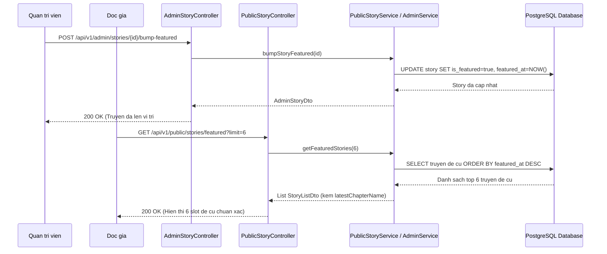

# Feature: Featured Stories Management & Navigation Refinement

- **Mã tính năng:** `F-18 / FEATURE-STORIES-NAV`
- **Trạng thái:** `Hoàn thành`
- **Ngày hoàn thành:** `2026-11-11`
- **Tác giả / Phụ trách:** `Antigravity AI Agent`
- **Nhánh Git liên quan:** `develop`

---

## 1. Tổng quan & Mục tiêu (Overview & Objectives)

- **Mục đích:** 
  1. Tái thiết kế toàn diện tính năng **Đề cử truyện (Featured Stories)**: Bổ sung trường thời gian `featuredAt`, API lấy danh sách truyện đề cử cho 6 slot trang chủ, cơ chế "Đưa lên đầu" (Bump to Top) cho phép quản trị viên tái đề cử bất kỳ truyện nào lên vị trí số 1 ngay lập tức.
  2. Phân định rõ ràng giữa hai chức năng **Thể loại (Genres)** và **Mới cập nhật (Latest Updates)**: Thêm Mega Dropdown trên Header cho Thể loại, cá nhân hóa tiêu đề/phụ đề trang theo ngữ cảnh URL, và đồng bộ thông tin chương mới nhất (`latestChapterName`) lên DTO truyện.
- **Phạm vi:** 
  - Backend `struyen_be`: Entity `Story`, `StoryListDto`, `AdminStoryDto`, `StoryRepository`, `PublicStoryService`, `PublicStoryController`, `AdminService`, `AdminStoryController`, `DataInitializer`.
  - Frontend `komika-fe`: `backend-types.ts`, `comics.endpoints.ts`, `comics.api.ts`, `comics.mapper.ts`, `admin.endpoints.ts`, `admin.api.ts`, `AdminStoryTab.tsx`, `Header.tsx`, `GenrePage.tsx`, `page.tsx` (Trang chủ).
- **Yêu cầu kỹ thuật:** JPA EntityGraph, PostgreSQL Indexing, Spring Security Method Security, Next.js App Router, Tailwind CSS.

---

## 2. Thiết kế kiến trúc & Luồng xử lý (Architecture & Workflow)



---

## 3. Thay đổi Cơ sở dữ liệu (Database Changes)

- **Bảng sửa đổi:** `story`
- **Cột bổ sung:**
  - `featured_at` (`TIMESTAMP WITHOUT TIME ZONE`): Lưu thời điểm truyện được đánh dấu đề cử hoặc được "Đưa lên đầu".
  - `latest_chapter_name` (`VARCHAR(255)`): Lưu tên số chương mới nhất phục vụ hiển thị nhanh badge mà không cần truy vấn bảng `chapter`.
- **Chỉ mục bổ sung:**
  - `idx_story_featured`: Index kết hợp `(is_featured, featured_at DESC)` giúp truy vấn 6 slot đề cử đạt hiệu năng cao nhất.

---

## 4. Các file mã nguồn chính (Key Source Files)

- **Backend (`struyen_be`):**
  - Entity: [Story.java](file:///d:/Code/struyen_be/src/main/java/com/struyen/struyen/entities/Story.java)
  - DTO: [StoryListDto.java](file:///d:/Code/struyen_be/src/main/java/com/struyen/struyen/dtos/StoryListDto.java), [AdminStoryDto.java](file:///d:/Code/struyen_be/src/main/java/com/struyen/struyen/dtos/AdminStoryDto.java)
  - Repository: [StoryRepository.java](file:///d:/Code/struyen_be/src/main/java/com/struyen/struyen/repositories/StoryRepository.java)
  - Service: [PublicStoryService.java](file:///d:/Code/struyen_be/src/main/java/com/struyen/struyen/services/PublicStoryService.java), [AdminService.java](file:///d:/Code/struyen_be/src/main/java/com/struyen/struyen/services/AdminService.java)
  - Controller: [PublicStoryController.java](file:///d:/Code/struyen_be/src/main/java/com/struyen/struyen/controllers/PublicStoryController.java), [AdminStoryController.java](file:///d:/Code/struyen_be/src/main/java/com/struyen/struyen/controllers/AdminStoryController.java)
  - Initializer: [DataInitializer.java](file:///d:/Code/struyen_be/src/main/java/com/struyen/struyen/config/DataInitializer.java)

- **Frontend (`komika-fe`):**
  - Types: [backend-types.ts](file:///d:/Code/komika-fe/src/lib/api/backend-types.ts), [types.ts](file:///d:/Code/komika-fe/src/features/admin/types.ts)
  - Endpoints & API: [comics.endpoints.ts](file:///d:/Code/komika-fe/src/features/comics/api/comics.endpoints.ts), [comics.api.ts](file:///d:/Code/komika-fe/src/features/comics/api/comics.api.ts), [admin.endpoints.ts](file:///d:/Code/komika-fe/src/features/admin/api/admin.endpoints.ts), [admin.api.ts](file:///d:/Code/komika-fe/src/features/admin/api/admin.api.ts)
  - Mappers & Components: [comics.mapper.ts](file:///d:/Code/komika-fe/src/features/comics/api/comics.mapper.ts), [AdminStoryTab.tsx](file:///d:/Code/komika-fe/src/features/admin/components/AdminStoryTab.tsx), [page.tsx](file:///d:/Code/komika-fe/src/app/page.tsx), [Header.tsx](file:///d:/Code/komika-fe/src/shared/components/Header.tsx), [GenrePage.tsx](file:///d:/Code/komika-fe/src/features/comics/pages/GenrePage.tsx)

---

## 5. Danh sách API Endpoints

### 5.1 `GET /api/v1/public/stories/featured`
- **Mô tả:** Lấy danh sách truyện đề cử cho Trang chủ (sắp xếp theo `featuredAt DESC`). Nếu số truyện đề cử nhỏ hơn giới hạn, tự động bổ sung truyện có lượt xem cao nhất.
- **Parameters:**
  - `limit`: Số lượng truyện cần lấy (mặc định 6, tối đa 20).
- **Response mẫu (200 OK):**
```json
[
  {
    "id": "md-6b958848-c885-4735-9201-12ee77abcb3c",
    "name": "Gia Đình Điệp Viên",
    "slug": "gia-dinh-diep-vien",
    "isFeatured": true,
    "featuredAt": "2026-11-11T16:50:50.187",
    "latestChapterName": "33"
  }
]
```

### 5.2 `POST /api/v1/admin/stories/{id}/bump-featured`
- **Mô tả:** Đưa truyện lên vị trí đầu tiên trong danh sách Đề cử Trang chủ (cập nhật `featuredAt = NOW()` và `isFeatured = true`).
- **Headers:** `Authorization: Bearer <token>`
- **Response mẫu (200 OK):** `AdminStoryDto` với thông tin cập nhật mới nhất.

### 5.3 `GET /api/v1/admin/stories/featured`
- **Mô tả:** Lấy toàn bộ danh sách truyện đang được đề cử để quản trị viên theo dõi.
- **Headers:** `Authorization: Bearer <token>`
- **Response mẫu (200 OK):** Mảng các `AdminStoryDto`.

---

## 6. Hướng dẫn kiểm thử & Xác minh (Testing & Verification)

1. **Kiểm tra API Đề cử:**
   ```bash
   curl -s http://localhost:8080/api/v1/public/stories/featured?limit=6
   ```
2. **Kiểm tra API Bump Đề cử:**
   ```bash
   curl -s -X POST http://localhost:8080/api/v1/admin/stories/<story-id>/bump-featured \
     -H "Authorization: Bearer <admin-token>"
   ```
3. **Kiểm tra Giao diện:**
   - Trang chủ (`/`): Section Đề cử hiển thị đúng 6 truyện từ API `getFeaturedComics`.
   - Trang Admin (`/admin` -> Quản lý Truyện): Truyện được đề cử hiển thị nút "Đưa lên đầu", bấm vào sẽ lập tức đưa truyện lên top #1.
   - Header: Hover vào "THỂ LOẠI" hiển thị Mega Dropdown danh mục thể loại; bấm "MỚI CẬP NHẬT" hiển thị đúng tiêu đề "TRUYỆN MỚI CẬP NHẬT".

