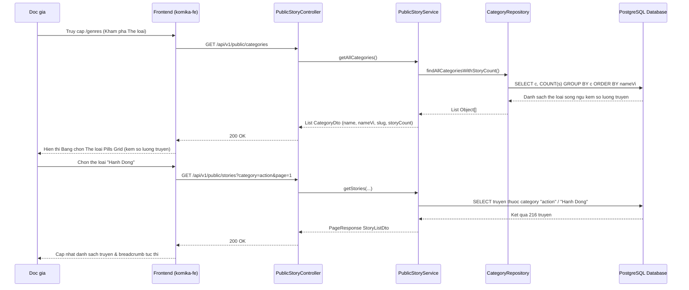

# Feature: Bilingual Categories & Dedicated Latest vs Genre Pages

- **Mã tính năng:** `F-19 / BILINGUAL-CATEGORIES-PAGE-SEPARATION`
- **Trạng thái:** `Hoàn thành`
- **Ngày hoàn thành:** `2026-11-11`
- **Tác giả / Phụ trách:** `Antigravity AI Agent`
- **Nhánh Git liên quan:** `develop`

---

## 1. Tổng quan & Mục tiêu (Overview & Objectives)

- **Mục đích:** 
  1. Thêm trường `nameVi` vào bảng `category` và đồng bộ từ điển song ngữ chuẩn hóa 100% 76 thể loại trong database, kèm `storyCount` đếm số lượng truyện thực tế.
  2. Loại bỏ ô tìm kiếm và bộ lọc trùng lặp bên dưới thân trang, đồng bộ tìm kiếm toàn cục duy nhất trên Header.
  3. Tách bạch hoàn toàn hai trang riêng biệt: Trang **Mới cập nhật (`/latest`)** tập trung vào dòng thời gian chương mới, và Trang **Thể loại (`/genres`)** với Bộ công cụ lọc thể loại chuyên sâu (Category Filter Suite) thay thế thanh slider trượt ngang.
- **Phạm vi:** 
  - Backend `struyen_be`: Entity `Category`, `CategoryDto`, `CategoryRepository`, `PublicStoryService`, `PublicStoryController`, `MangaDexSyncService`, `DataInitializer`.
  - Frontend `komika-fe`: `backend-types.ts`, `comics.endpoints.ts`, `comics.api.ts`, `comics.mapper.ts`, `GenrePage.tsx`, `LatestUpdatesPage.tsx`, `/app/latest/page.tsx`, `/app/genres/page.tsx`, `Header.tsx`, `page.tsx` (Trang chủ).
- **Yêu cầu kỹ thuật:** JPA Custom Aggregation Query (`COUNT DISTINCT`), Bilingual Schema Migration, Next.js App Router, Tailwind CSS.

---

## 2. Thiết kế kiến trúc & Luồng xử lý (Architecture & Workflow)



---

## 3. Thay đổi Cơ sở dữ liệu (Database Changes)

- **Bảng sửa đổi:** `category`
- **Cột bổ sung:**
  - `name_vi` (`VARCHAR(255)`): Tên thể loại bằng tiếng Việt có dấu chuẩn hóa (ví dụ: "Hành Động", "Lãng Mạn", "Chuyển Sinh", "Cảnh Sát / Trinh Thám"...).
- **Chỉ mục bổ sung:**
  - `idx_category_name_vi`: Index trên cột `name_vi` phục vụ tra cứu nhanh.
- **Dữ liệu backfill:** 76/76 thể loại hiện có được cập nhật đầy đủ song ngữ `name` (tiếng Anh) và `name_vi` (tiếng Việt).

---

## 4. Các file mã nguồn chính (Key Source Files)

- **Backend (`struyen_be`):**
  - Entity: [Category.java](file:///d:/Code/struyen_be/src/main/java/com/struyen/struyen/entities/Category.java)
  - DTO: [CategoryDto.java](file:///d:/Code/struyen_be/src/main/java/com/struyen/struyen/dtos/CategoryDto.java)
  - Repository: [CategoryRepository.java](file:///d:/Code/struyen_be/src/main/java/com/struyen/struyen/repositories/CategoryRepository.java)
  - Service: [PublicStoryService.java](file:///d:/Code/struyen_be/src/main/java/com/struyen/struyen/services/PublicStoryService.java), [MangaDexSyncService.java](file:///d:/Code/struyen_be/src/main/java/com/struyen/struyen/services/MangaDexSyncService.java)
  - Controller: [PublicStoryController.java](file:///d:/Code/struyen_be/src/main/java/com/struyen/struyen/controllers/PublicStoryController.java)
  - Initializer: [DataInitializer.java](file:///d:/Code/struyen_be/src/main/java/com/struyen/struyen/config/DataInitializer.java)

- **Frontend (`komika-fe`):**
  - Types: [backend-types.ts](file:///d:/Code/komika-fe/src/lib/api/backend-types.ts)
  - API Client: [comics.api.ts](file:///d:/Code/komika-fe/src/features/comics/api/comics.api.ts), [comics.endpoints.ts](file:///d:/Code/komika-fe/src/features/comics/api/comics.endpoints.ts)
  - Pages:
    - [LatestUpdatesPage.tsx](file:///d:/Code/komika-fe/src/features/comics/pages/LatestUpdatesPage.tsx) (`/latest`)
    - [GenrePage.tsx](file:///d:/Code/komika-fe/src/features/comics/pages/GenrePage.tsx) (`/genres`)
  - Routes:
    - `/app/latest/page.tsx`
    - `/app/genres/page.tsx`
  - Navigation: [Header.tsx](file:///d:/Code/komika-fe/src/shared/components/Header.tsx), [page.tsx](file:///d:/Code/komika-fe/src/app/page.tsx)

---

## 5. Danh sách API Endpoints

### 5.1 `GET /api/v1/public/categories`
- **Mô tả:** Lấy danh sách toàn bộ thể loại song ngữ (kèm `storyCount` số lượng truyện thực tế).
- **Response mẫu (200 OK):**
```json
[
  {
    "id": "cat-action",
    "name": "Action",
    "nameVi": "Hành Động",
    "slug": "action",
    "storyCount": 216
  },
  {
    "id": "cat-romance",
    "name": "Romance",
    "nameVi": "Lãng Mạn",
    "slug": "romance",
    "storyCount": 338
  }
]
```

### 5.2 `GET /api/v1/public/stories`
- **Mô tả:** Hỗ trợ lọc đa tiêu chí: `category`, `sort`, `status` (`ongoing` / `completed`), `q`, `page`, `size`.
- **Response mẫu (200 OK):** `PageResponse<StoryListDto>`

---

## 6. Hướng dẫn kiểm thử & Xác minh (Testing & Verification)

1. **Kiểm tra API Thể loại:**
   ```bash
   curl -s http://localhost:8080/api/v1/public/categories
   ```
2. **Kiểm tra Trang Mới Cập Nhật (`/latest`):**
   - Truy cập `http://localhost:3000/latest`.
   - Quan sát: Không còn slider thể loại, không còn ô search trùng lặp.
   - Thẻ truyện làm nổi bật số chương và thời gian phát hành tương đối.
3. **Kiểm tra Trang Thể Loại (`/genres`):**
   - Truy cập `http://localhost:3000/genres`.
   - Quan sát: Bảng chọn thể loại trực quan (Pills Grid) hiển thị tiếng Việt kèm số lượng truyện thực tế.
   - Bấm chọn thể loại: URL cập nhật `?genre=...`, danh sách truyện lọc tương ứng ngay lập tức.
   - Thử nghiệm các bộ lọc phụ: Tiến độ, Sắp xếp, View mode.
