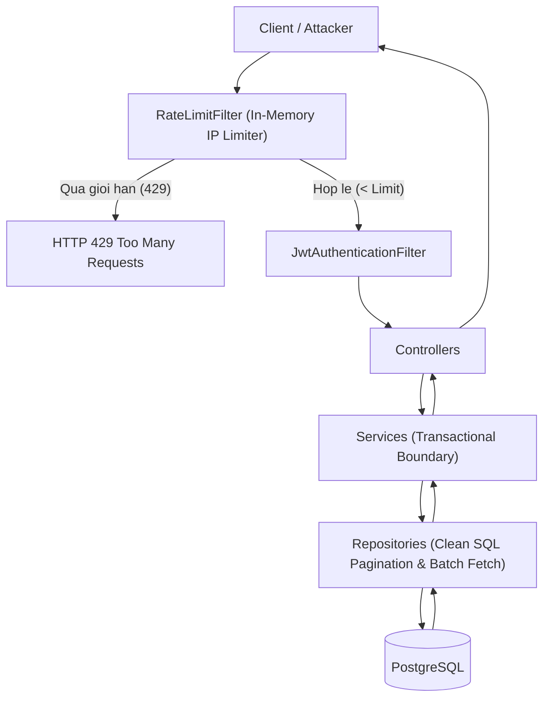

# Feature: Toi uu hoa Hieu nang & Phong ve Spam/DDoS toan dien (Performance & Security Hardening)

- **Ma tinh nang:** `F-20 / PERF-SECURITY-HARDENING`
- **Trang thai:** Hoan thanh
- **Ngay hoan thanh:** 2026-11-12
- **Tac gia / Phu trach:** AI Agent
- **Nhanh Git lien quan:** `develop`

---

## 1. Tong quan & Muc tieu (Overview & Objectives)

- **Muc dich:** 
  - Khac phuc triet de cac diem nghen hieu nang CSDL: canh bao Hibernate in-memory pagination (`HHH90003004`), over-fetching du lieu `imagesJson` (jsonb) tai chi tiet chuong, van de N+1 query trong he thong binh luan.
  - Loai bo nguy co can kiet database connection pool thong qua viec tat `open-in-view` va toi uu bo thong so HikariCP.
  - Xay dung co che phong ve tu choi dich vu (Rate Limiting Filter) chong tan cong vet can CPU (BCrypt brute-force), spam tao tai khoan va flood binh luan.
  - Kiem soat dong thoi (Concurrency Mutex) cho cac tien trinh cao du lieu Admin (Otruyen & MangaDex sync).

- **Pham vi:**
  - `StoryRepository`, `Story` entity (batch fetching `@BatchSize`, go bo `@EntityGraph` tren truy van phan trang).
  - `ChapterRepository`, `PublicStoryService` (truy van gon nhe `findShortChaptersByStoryId`, bo qua mảng jsonb khi doc chi tiet).
  - `CommentRepository`, `CommentService` (truy van gop `findByParentIdInAndIsDeletedFalseOrderByCreatedAtAsc`).
  - `RateLimitFilter`, `SecurityConfig` (kiem soat tan suat request theo IP).
  - `AdminSyncController`, `OtruyenSyncService`, `MangaDexSyncService` (khoa `AtomicBoolean` chong trigger song song).
  - `application.properties` (tat `open-in-view`, tinh chinh HikariCP va Tomcat threads).

---

## 2. Thiet ke kien truc & Luong xu ly (Architecture & Workflow)

---

## 3. Thay doi Co so du lieu (Database Changes)

- **Bo sung composite indexes:**
  - `story`: `idx_story_active_views` tren `(is_active, view_count DESC)`.
  - `story`: `idx_story_active_updated` tren `(is_active, updated_at DESC)`.
  - Giup cac truy van trang chu (Moi cap nhat, Top doc nhieu) su dung Index Scan thay vi Sequential Scan.

---

## 4. Cac file ma nguon chinh (Key Source Files)

- **Security & Rate Limiting:**
  - `src/main/java/com/struyen/struyen/security/RateLimitFilter.java`
  - `src/main/java/com/struyen/struyen/config/SecurityConfig.java`
- **Entities & Repositories:**
  - `src/main/java/com/struyen/struyen/entities/Story.java`
  - `src/main/java/com/struyen/struyen/repositories/StoryRepository.java`
  - `src/main/java/com/struyen/struyen/repositories/ChapterRepository.java`
  - `src/main/java/com/struyen/struyen/repositories/CommentRepository.java`
- **Services:**
  - `src/main/java/com/struyen/struyen/services/PublicStoryService.java`
  - `src/main/java/com/struyen/struyen/services/CommentService.java`
  - `src/main/java/com/struyen/struyen/services/OtruyenSyncService.java`
  - `src/main/java/com/struyen/struyen/services/MangaDexSyncService.java`
- **Controllers & Config:**
  - `src/main/java/com/struyen/struyen/controllers/AdminSyncController.java`
  - `src/main/resources/application.properties`
  - `src/test/java/com/struyen/struyen/security/RateLimitFilterTest.java`

---

## 5. Danh sach API anh huong / Kiem soat

| Method | Endpoint | Gioi han Rate Limit | Mo ta |
|---|---|---|---|
| POST | `/api/v1/auth/login` | 10 req / phut / IP | Chong tan cong vet can mat khau & ep tai CPU qua BCrypt |
| POST | `/api/v1/auth/register` | 5 req / 5 phut / IP | Chong script tao tai khoan rac tu dong |
| POST | `/api/v1/me/comments` | 10 req / phut / IP | Chong flood binh luan |
| POST | `/api/v1/admin/sync/full` | Khoa Mutex (1 tien trinh) | Tra ve 409 Conflict neu tien trinh Otruyen dang chay |
| POST | `/api/v1/admin/sync/mangadex/*` | Khoa Mutex (1 tien trinh) | Tra ve 409 Conflict neu tien trinh MangaDex dang chay |

---

## 6. Kiem thu & Xac minh (Verification)

1. **In-Memory Pagination:**
   - Xac nhan log khoi dong va thuc thi khong con canh bao `HHH90003004`.
   - Cac truy van phan trang duoc thuc thi truc tiep voi SQL `LIMIT ? OFFSET ?`.
2. **Over-fetching JSONB:**
   - Khi doc chuong hoac chi tiet truyen, `findShortChaptersByStoryId` chi truy van 4 cot co ban, khong mang theo chuoi jsonb anh cua cac chuong khac.
3. **N+1 Query:**
   - Danh sach binh luan kem replies chi thuc hien 2 cau truy van gom nhom.
4. **Rate Limit:**
   - `RateLimitFilterTest` vuot qua 3/3 test cases (cho phep req hop le, chan HTTP 429 khi vuot nguong, bo qua GET requests).
5. **Toan bo Test Suite:**
   - 18/18 test cases vuot qua thanh cong (`BUILD SUCCESS`).
