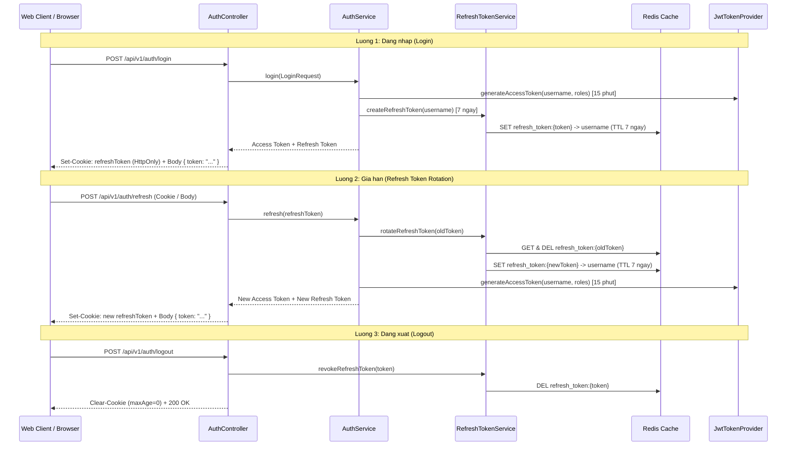

# Feature: Refresh Token & Dual-Token Authentication

- **Mã tính năng:** `F-21` / `REFRESH-TOKEN-AUTH`
- **Trạng thái:** Hoàn thành
- **Ngày hoàn thành:** 2026-11-12
- **Tác giả / Phụ trách:** Antigravity AI Agent & Developer
- **Nhánh Git liên quan:** `develop`

---

## 1. Tổng quan & Mục tiêu (Overview & Objectives)

- **Mục đích:** Chuyển đổi mô hình xác thực từ Single Token (Access Token 24h) sang Dual-Token Architecture (Access Token ngắn hạn 15 phút + Refresh Token dài hạn 7 ngày lưu trữ trong Redis) nhằm hạn chế tối đa rủi ro lộ lọt Access Token qua tấn công XSS, hỗ trợ thu hồi token chủ động (Token Revocation) và triển khai cơ chế Refresh Token Rotation chống Replay Attack.
- **Phạm vi:**
  - Cấu hình thời gian sống phân tách cho Access Token (15 phút) và Refresh Token (7 ngày).
  - Tích hợp `RefreshTokenService` quản lý vòng đời Refresh Token trên Redis.
  - Hỗ trợ lưu trữ Refresh Token qua `HttpOnly Cookie` (ưu tiên cho trình duyệt Web) và Request Body (fallback cho client phi trình duyệt).
  - Bổ sung các API: `POST /api/v1/auth/refresh`, `POST /api/v1/auth/logout`.
  - Tự động thu hồi Refresh Token khi người dùng đổi mật khẩu (`changePassword`).
  - Áp dụng Rate Limiting bảo vệ endpoint `/api/v1/auth/refresh`.

---

## 2. Thiết kế kiến trúc & Luồng xử lý (Architecture & Workflow)

---

## 3. Thay đổi Cơ sở dữ liệu & Cấu hình (Database & Config Changes)

- **Database:** Không thay đổi schema PostgreSQL. Toàn bộ Refresh Token được quản lý trên Redis với TTL tự động để tối ưu hiệu năng I/O.
- **Redis Key Patterns:**
  - `refresh_token:{tokenString}` -> Lưu trữ `username` (TTL: 7 ngày).
  - `user_refresh_tokens:{username}` -> Lưu tập hợp (Set) các Refresh Token hợp lệ của user (hỗ trợ thu hồi hàng loạt khi đổi mật khẩu).
- **Cấu hình `application.properties`:**
  - `jwt.access-expiration-ms`: 900000 (15 phút).
  - `jwt.refresh-expiration-ms`: 604800000 (7 ngày).
  - `jwt.cookie.name`: refreshToken.
  - `jwt.cookie.secure`: false (môi trường dev local), true (môi trường production).
  - `jwt.cookie.same-site`: Lax.

---

## 4. Các file mã nguồn chính (Key Source Files)

- **Config & Security:**
  - `src/main/resources/application.properties`: Bổ sung thời gian sống và cấu hình cookie.
  - `src/main/java/com/struyen/struyen/security/JwtTokenProvider.java`: Tinh chỉnh TTL Access Token 15 phút.
  - `src/main/java/com/struyen/struyen/config/SecurityConfig.java`: Phân quyền permitAll cho refresh/logout.
  - `src/main/java/com/struyen/struyen/security/RateLimitFilter.java`: Bổ sung rate limit cho endpoint refresh.
- **DTOs:**
  - `src/main/java/com/struyen/struyen/dtos/RefreshTokenRequest.java`: DTO nhận refresh token qua request body.
  - `src/main/java/com/struyen/struyen/dtos/AuthResponse.java`: Bổ sung trường refreshToken (dành cho client phi trình duyệt).
- **Services:**
  - `src/main/java/com/struyen/struyen/services/RefreshTokenService.java`: Quản lý sinh mã, kiểm tra, xoay vòng và thu hồi token trên Redis.
  - `src/main/java/com/struyen/struyen/services/AuthService.java`: Tích hợp luồng refresh, logout và revoke khi đổi mật khẩu.
- **Controllers:**
  - `src/main/java/com/struyen/struyen/controllers/AuthController.java`: Thêm endpoint `/refresh` và `/logout`, xử lý `HttpOnly Cookie`.

---

## 5. Danh sách API bổ sung & cập nhật (API Endpoints)

| Method | Endpoint | Quyền truy cập | Mô tả |
|---|---|---|---|
| POST | `/api/v1/auth/login` | Public | Đăng nhập: Cấp Access Token trong body và Refresh Token trong HttpOnly Cookie |
| POST | `/api/v1/auth/register` | Public | Đăng ký: Cấp Access Token và Refresh Token tương tự login |
| POST | `/api/v1/auth/refresh` | Public | Đổi Refresh Token lấy Access Token mới (kèm Refresh Token mới - Rotation) |
| POST | `/api/v1/auth/logout` | Public / Auth | Đăng xuất: Thu hồi Refresh Token trên Redis và xóa Cookie trên Client |

---

## 6. Kế hoạch & Kết quả kiểm thử (Verification Steps & Results)

1. **Unit Test:**
   - `RefreshTokenServiceTest`: 7/7 test cases vượt qua (Tạo token, kiểm tra hợp lệ, xoay vòng rotation, từ chối token hết hạn, thu hồi token đơn lẻ, thu hồi toàn bộ khi đổi mật khẩu).
   - `AuthServiceTest`: 7/7 test cases vượt qua (Đăng ký cấp dual-token, đăng nhập cấp dual-token, gia hạn token rotation, từ chối token rỗng, chặn user bị ban, logout thu hồi token, đổi mật khẩu thu hồi toàn bộ token).
   - Toàn bộ test suite dự án: 37/37 tests vượt qua (0 failures, 0 errors).
2. **Integration Test Flow:**
   - Đăng nhập lấy Cookie `refreshToken` và Access Token.
   - Gọi endpoint private `/api/v1/auth/me` với Access Token.
   - Gia hạn token qua `POST /api/v1/auth/refresh`, kiểm tra token cũ bị thu hồi và token mới được cấp.
   - Đăng xuất qua `POST /api/v1/auth/logout`, xác nhận cookie bị xóa và Redis key bị thu hồi.

