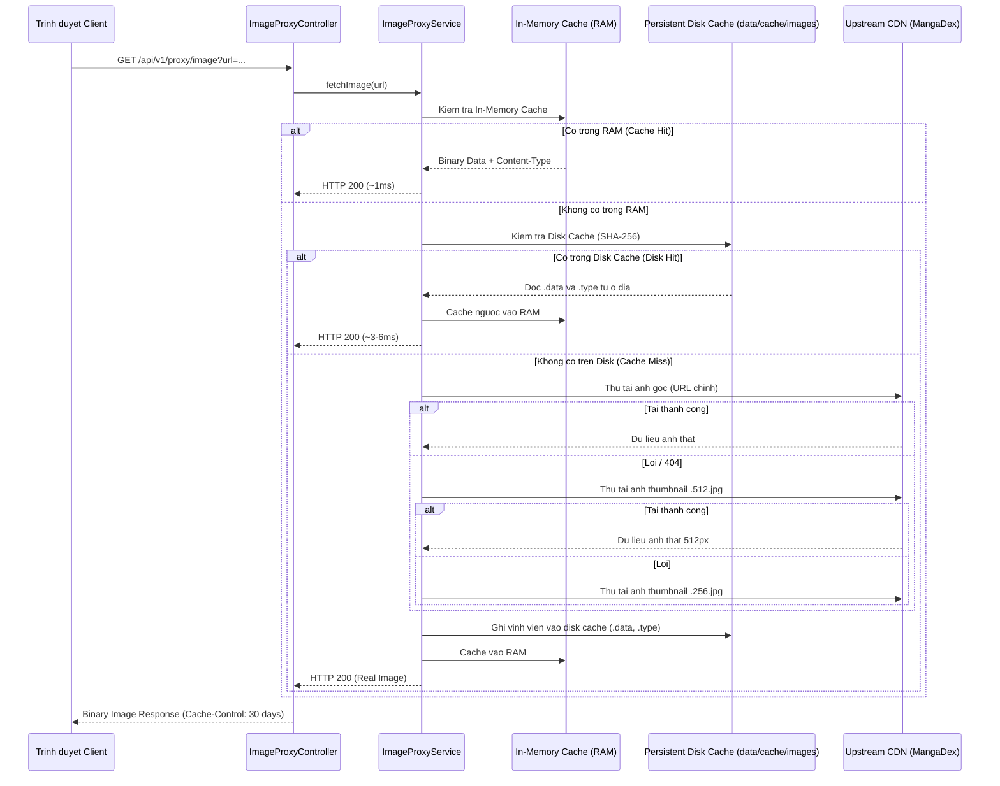

# Feature: Toi uu hoa Image Proxy voi Persistent Disk Cache va Real Image Retrieval

- **Ma tinh nang:** `F-22 / IMAGE-PROXY-OPT`
- **Trang thai:** Hoan thanh
- **Ngay hoan thanh:** 2026-11-12
- **Tac gia / Phu trach:** AI Agent
- **Nhanh Git lien quan:** `develop`

---

## 1. Tong quan & Muc tieu (Overview & Objectives)

- **Muc dich:** 
  - Lay anh thuc te (real image) tu CDN quoc te bang moi gia thay vi hien thi placeholder fallback SVG.
  - Xay dung bo nho dem o dia lau dai (Persistent Disk Cache) tai `data/cache/images/` su dung ma bam SHA-256 de luu tru vinh vien cac anh that da tai ve.
  - Phuc vu anh tuc thi trong 1 - 6ms cho tat ca cac yeu cau truy cap sau do, hoan toan doc lap voi ket noi mang toi CDN goc.
  - Ho tro co che lay anh nhieu cap cho MangaDex (Multi-tier Resolution): neu anh bia goc bi loi hoac khong truy cap duoc, he thong tu dong thu tai cac phien ban anh that 512px (`.512.jpg`) va 256px (`.256.jpg`).
  - Giam thieu toi da tai nguyen mang quoc te va bo qua hoan toan dependency voi Otruyen API da ngung hoat dong.
- **Pham vi:**
  - `RestTemplateConfig.java`: Cau hinh Connect Timeout (5s), Response Timeout (12s) de tai tron ven anh goc dung luong lon tu CDN quoc te; co che retry 2 lan voi backoff 500ms giup vuot qua su co mang chap chon. Connection Pool: `maxConnTotal: 200`, `maxConnPerRoute: 50`.
  - `ImageProxyService.java`:
    - Bo hoan toan Negative Cache (khong cache loi).
    - Disk Cache luu vao `data/cache/images/{sha256}.data` va `{sha256}.type`.
    - Memory Cache RAM (TTL 1 gio, 500 anh hot dung luong <= 1MB).
    - Multi-tier retrieval cho MangaDex covers.
  - Frontend (`komika-fe`): Loai bo quy tac chuan hoa Otruyen CDN prefix trong `toProxiedImageUrl`.

---

## 2. Thiet ke kien truc & Luong xu ly (Architecture & Workflow)



---

## 3. Thay doi Co so du lieu (Database Changes)

- Khong thay doi schema PostgreSQL. Du lieu anh duoc luu tru tren file system dia phuong tai `data/cache/images/`.

---

## 4. Thay doi Ma nguon (Code Changes)

- **`src/main/java/com/struyen/struyen/config/RestTemplateConfig.java`:**
  - `setConnectTimeout(Timeout.ofSeconds(5))`.
  - `setResponseTimeout(Timeout.ofSeconds(12))`.
  - `setRetryStrategy(new DefaultHttpRequestRetryStrategy(2, TimeValue.ofMilliseconds(500)))`: Tu dong thu lai 2 lan khi mang bi ngat ket noi tam thoi.
  - Tang connection pool: `maxConnTotal: 200`, `maxConnPerRoute: 50`.
- **`src/main/java/com/struyen/struyen/services/ImageProxyService.java`:**
  - Xoa bo Negative Cache.
  - Tich hop Persistent Disk Cache vao thu muc `data/cache/images/`.
  - Tich hop MangaDex multi-tier resolution (`imageUrl`, `imageUrl.512.jpg`, `imageUrl.256.jpg`).
  - Bo sung `clearCaches()` phuc vu testing.
- **`src/test/java/com/struyen/struyen/services/ImageProxyServiceTest.java`:**
  - Kiem thu Memory Cache (`shouldServeFromMemoryCacheOnSubsequentRequest`).
  - Kiem thu Multi-tier MangaDex resolution (`shouldFallbackTo512MangaDexCoverWhenOriginalFails`).
  - Kiem thu doc tu Disk Cache (`shouldServeFromDiskCacheWhenMemoryCacheCleared`).
- **`komika-fe/src/lib/api/http-client.ts`:**
  - Don dep legacy Otruyen CDN prefix trong ham `toProxiedImageUrl`.

---

## 5. Danh sach API lien quan (API Endpoints)

| Method | Endpoint | Mo ta | Cache Behavior |
|---|---|---|---|
| GET | `/api/v1/proxy/image?url={rawUrl}` | Proxy anh va luu cache dia phuong | RAM Hit (~1ms), Disk Hit (~5ms), Cache Miss (Tai tu MangaDex va luu vao o dia) |

---

## 6. Kiem thu & Xac minh (Verification & Testing)

1. **Unit Tests Backend:**
   ```bash
   ./mvnw test -Dtest=ImageProxyServiceTest
   # Tests run: 9, Failures: 0, Errors: 0, Skipped: 0
   ```
2. **Full Regression Test Suite:**
   ```bash
   ./mvnw test
   # Tests run: 40, Failures: 0, Errors: 0, Skipped: 0
   ```
3. **Kiem thu toc do phan hoi thuc te (End-to-End):**
   - Lan 1 (Cache Miss): Tai anh cover that tu MangaDex (~743 KB), luu vao disk cache.
   - Lan 2 (Cache Hit): Phan hoi trong **0.0067s** (6.7ms) truc tiep tu cache.
