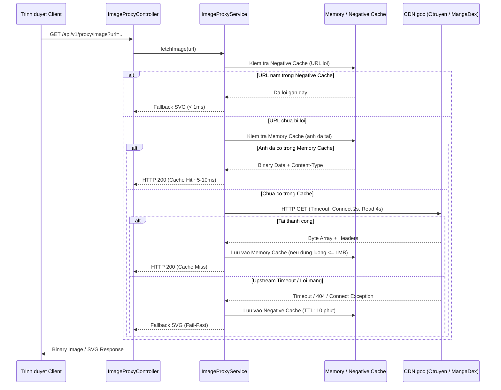

# Feature: Toi uu hoa Image Proxy va Khac phuc nghen luong Tomcat

- **Ma tinh nang:** `F-22 / IMAGE-PROXY-OPT`
- **Trang thai:** Hoan thanh
- **Ngay hoan thanh:** 2026-11-12
- **Tac gia / Phu trach:** AI Agent
- **Nhanh Git lien quan:** `develop`

---

## 1. Tong quan & Muc tieu (Overview & Objectives)

- **Muc dich:** 
  - Khac phuc triet de van de server bi cham, treo va nghen luong xu ly Tomcat khi nguoi dung moi vao trang web hoac tai nhieu anh dong thoi tu cac CDN quoc te (Otruyen, MangaDex).
  - Loai bo hien tuong Tomcat bi giu luong 20 - 40 giay cho cac anh bi loi DNS hoac bi nha mang chan (DDoS-Guard / Cloudflare timeout).
  - Cai thien toc do phan hoi anh bia va chapter xuong duoi 10ms thong qua Memory Caching va Negative Caching.
- **Pham vi:**
  - `RestTemplateConfig.java`: Cau hinh giam Connect Timeout (2s), Response Timeout (4s) va chien luoc Fail-Fast (0 retries).
  - `ImageProxyService.java`: Bo sung Negative Caching (10 phut) cho URL loi va In-Memory Caching (1 gio, toi da 400 anh bia <= 1MB).
  - Don dep cache Redis tranh loi xung dot serialization tren endpoint `featured_stories`.
- **Yeu cau ky thuat:**
  - Java 21, Spring Boot 3.5.x, Apache HttpClient 5.

---

## 2. Thiet ke kien truc & Luong xu ly (Architecture & Workflow)



---

## 3. Thay doi Co so du lieu (Database Changes)

- Khong co thay doi schema PostgreSQL (tinh nang hoan toan thuoc tang mang va caching in-memory).

---

## 4. Thay doi Ma nguon (Code Changes)

- **`src/main/java/com/struyen/struyen/config/RestTemplateConfig.java`:**
  - `setConnectTimeout(Timeout.ofSeconds(2))`: Giam tu 6s xuong 2s.
  - `setResponseTimeout(Timeout.ofSeconds(4))`: Giam tu 20s xuong 4s.
  - `setRetryStrategy(new DefaultHttpRequestRetryStrategy(0, TimeValue.ZERO_MILLISECONDS))`: Tat retry tu dong de giai phong luong ngay khi ket noi bi tu choi.
  - Tang connection pool: `maxConnTotal: 150`, `maxConnPerRoute: 40`.
- **`src/main/java/com/struyen/struyen/services/ImageProxyService.java`:**
  - Tich hop `failedUrlsCache` (Negative Cache voi TTL 10 phut, dung luong 5.000 URLs).
  - Tich hop `imageMemoryCache` (Memory Cache voi TTL 1 gio, dung luong 400 anh <= 1MB).
  - Bo sung ham `clearCaches()` phuc vu testing.
- **`src/test/java/com/struyen/struyen/services/ImageProxyServiceTest.java`:**
  - Bo sung unit test kiem thu Memory Cache (`shouldServeFromMemoryCacheOnSubsequentRequest`).
  - Bo sung unit test kiem thu Negative Cache (`shouldServeFromNegativeCacheWhenPreviousRequestFailed`).

---

## 5. Danh sach API lien quan (API Endpoints)

| Method | Endpoint | Mo ta | Cache Behavior |
|---|---|---|---|
| GET | `/api/v1/proxy/image?url={rawUrl}` | Proxy anh chong chan hotlink | Memory Cache Hit (< 10ms), Negative Cache Hit (< 5ms), Upstream Timeout (Max 4s) |
| GET | `/api/v1/public/stories/featured` | Danh sach truyen de cu trang chu | Redis Cache Hit (~25ms), TTL 15 phut |

---

## 6. Kiem thu & Xac minh (Verification & Testing)

1. **Unit Tests:**
   ```bash
   ./mvnw test -Dtest=ImageProxyServiceTest
   # Ket qua: 8/8 tests pass (100%), thoi gian thuc thi 3.2s.
   ```
2. **Full Test Suite:**
   ```bash
   ./mvnw test
   # Ket qua: 39/39 tests pass (100%), BUILD SUCCESS.
   ```
3. **Thuc te kiem tra do tre (Latency Test):**
   - Anh hop le (Lan 1): 1.01s (tai tu CDN va cache vao RAM).
   - Anh hop le (Lan 2): **0.007s (~7ms)** (phuc vu tu Memory Cache).
   - Anh loi (Lan 1): 0.22s (fail-fast va luu negative cache).
   - Anh loi (Lan 2): **0.004s (~4ms)** (tra ve fallback SVG tuc thi tu negative cache).
