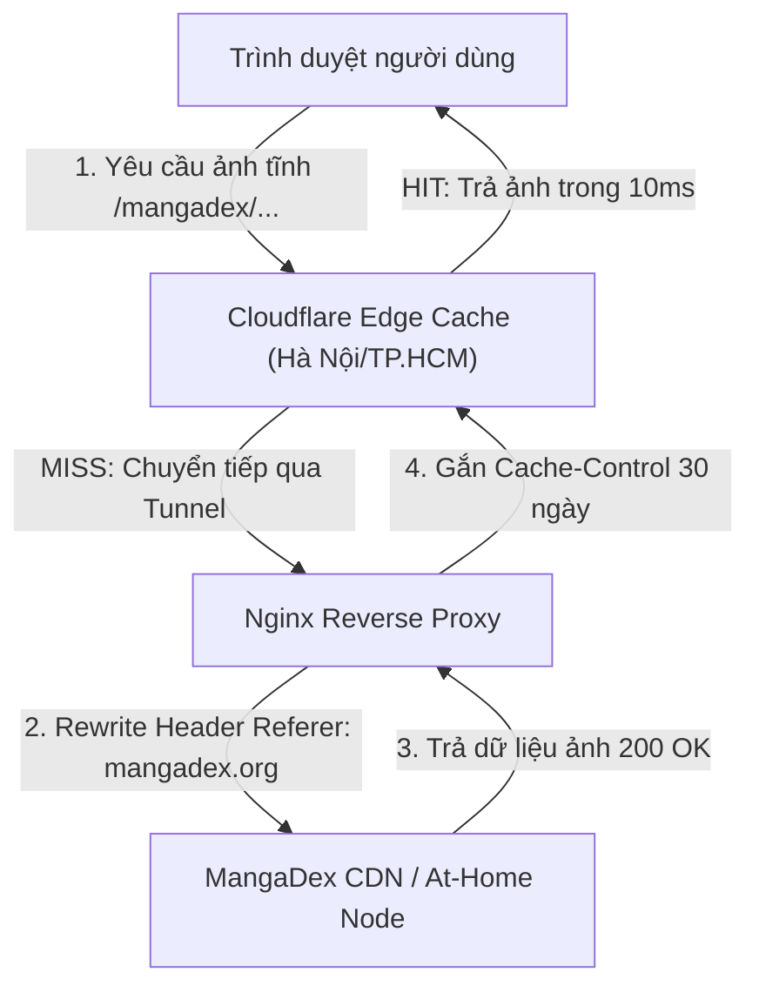

# Feature: MangaDex Clean Static Proxy & Edge Offload

- **Mã tính năng:** `F-25 / MANGADEX-CLEAN-PROXY-OFFLOAD`
- **Trạng thái:** Hoàn thành
- **Ngày hoàn thành:** 2026-11-18
- **Tác giả / Phụ trách:** Antigravity AI Agent
- **Nhánh Git liên quan:** `develop`

---

## 1. Tổng quan & Mục tiêu (Overview & Objectives)

- **Mục đích:** 
  - Loại bỏ hoàn toàn dynamic query proxy (`/api/v1/proxy/image?url=...`), chuyển sang Clean Static URLs có đuôi file tĩnh (`.jpg`, `.png`).
  - Bypass cơ chế chặn hotlink (HTTP 403 Forbidden) của MangaDex CDN (`uploads.mangadex.org` và `*.mangadex.network`) bằng cách inject HTTP headers hợp lệ tại tầng Nginx.
  - Giải phóng 100% dung lượng đĩa và tải CPU/RAM cho Spring Boot backend bằng cách offload việc cache ảnh trực tiếp lên Cloudflare Edge CDN.
  - Hỗ trợ cơ chế tự động phục hồi ảnh phía Frontend khi thiết bị mất mạng và có mạng trở lại.
- **Phạm vi:**
  - Nginx Reverse Proxy: Định tuyến `/mangadex/covers/*` và `/mangadex/network/*`.
  - Frontend: Mapper URL ảnh sạch và Route Handlers hỗ trợ môi trường dev cục bộ.
  - Backend: Tắt sync Otruyen, trả về URL sạch và giảm TTL Redis cho chapter detail xuống 10 phút.

---

## 2. Thiết kế kiến trúc & Luồng xử lý (Architecture & Workflow)

---

## 3. Thay đổi Cơ sở dữ liệu (Database Changes)

- Không thay đổi schema database.

---

## 4. Chi tiết các file thay đổi & thêm mới (Modified & Added Files)

### Backend (`struyen_be`):
1. `docker/nginx/nginx.conf`:
   - Thêm resolver DNS `1.1.1.1 8.8.8.8`.
   - Cấu hình khối proxy tĩnh `/mangadex/covers/` trỏ tới `https://uploads.mangadex.org/covers/`.
   - Cấu hình khối proxy động `/mangadex/network/` trỏ tới các node `*.mangadex.network`.
   - Gỡ bỏ cấu hình ghi đĩa cục bộ `proxy_cache img_cache`.
2. `src/main/java/com/struyen/struyen/services/PublicStoryService.java`:
   - Loại bỏ việc tạo URL dynamic proxy `/api/v1/proxy/image?url=...`.
   - Lấy fresh token từ MangaDex At-Home khi đọc chapter.
3. `src/main/java/com/struyen/struyen/config/RedisConfig.java`:
   - Hạ TTL của `CACHE_CHAPTER_DETAIL` xuống 10 phút để tránh hết hạn token MangaDex 15 phút.
4. `src/main/resources/application.properties`:
   - Tắt sync Otruyen: `sync.otruyen.enabled=false`.

### Frontend (`komika-fe`):
1. `src/lib/api/http-client.ts`:
   - Chuyển đổi URL ảnh bìa MangaDex thành `/mangadex/covers/{mangaId}/{fileName}`.
   - Chuyển đổi URL ảnh chapter thành `/mangadex/network/{node}/{path}`.
2. `src/app/mangadex/covers/[...path]/route.ts`:
   - Route handler hỗ trợ Next.js dev server tải ảnh bìa không bị 403.
3. `src/app/mangadex/network/[node]/[...path]/route.ts`:
   - Route handler hỗ trợ Next.js dev server tải ảnh chapter không bị 403.
4. `src/features/comics/components/ComicCoverCard.tsx` & `ComicDetailHero.tsx` & `ReadingPage.tsx`:
   - Lắng nghe sự kiện `online` để tự động retry tải ảnh khi mạng phục hồi.

---

## 5. Danh sách API & Endpoint

| Phương thức | Endpoint | Mô tả | Cache Control |
|---|---|---|---|
| `GET` | `/mangadex/covers/{mangaId}/{fileName}` | Proxy ảnh bìa truyện MangaDex | `public, max-age=2592000, immutable` |
| `GET` | `/mangadex/network/{node}/{type}/{hash}/{file}` | Proxy ảnh chapter MangaDex At-Home | `public, max-age=2592000, immutable` |
| `GET` | `/api/v1/public/chapters/{chapterId}` | API chi tiết chapter với link ảnh sạch | Redis Cache 10m |

---

## 6. Hướng dẫn kiểm thử & Xác minh (Verification)

1. Mở trang chủ: Kiểm tra thẻ ảnh có `src="/mangadex/covers/..."`, trả về HTTP 200 OK từ Nginx / Next.js route handler.
2. Mở đọc chapter: Kiểm tra các trang truyện có `src="/mangadex/network/..."`, không bị lỗi 403 Forbidden.
3. Kiểm tra header phản hồi: Phải có `Cache-Control: public, max-age=2592000, immutable`.
4. Mất mạng & Có mạng: Tắt kết nối internet trên trình duyệt, ảnh chuyển sang fallback; bật lại kết nối, ảnh tự động tải lại mà không cần F5.

