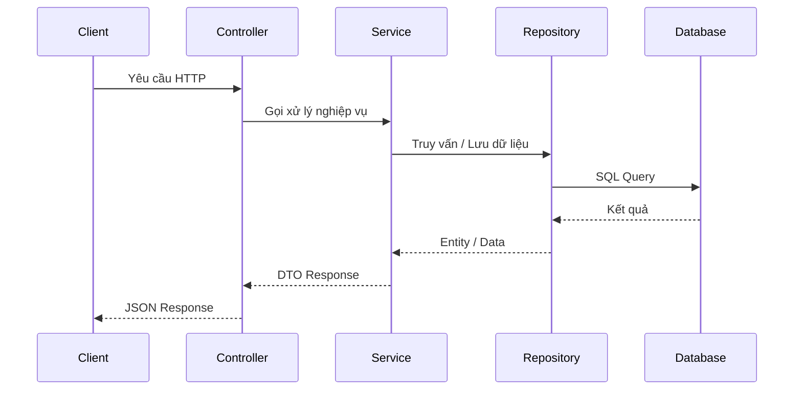

# Feature: [Tên tính năng]

- **Mã tính năng:** `[F-XX / FEATURE-CODE]`
- **Trạng thái:** `[Hoàn thành / Đang phát triển / Dự thảo]`
- **Ngày hoàn thành:** `[YYYY-MM-DD]`
- **Tác giả / Phụ trách:** `[Tên hoặc AI Agent]`
- **Nhánh Git liên quan:** `[develop / feature/xxx]`

---

## 1. Tổng quan & Mục tiêu (Overview & Objectives)

- **Mục đích:** Mô tả ngắn gọn tính năng giải quyết vấn đề gì.
- **Phạm vi:** Những gì được bao gồm và không bao gồm trong tính năng này.
- **Yêu cầu kỹ thuật:** Các thư viện, giao thức hoặc dịch vụ ngoài cần dùng.

---

## 2. Thiết kế kiến trúc & Luồng xử lý (Architecture & Workflow)



---

## 3. Thay đổi Cơ sở dữ liệu (Database Changes)

- **Bảng tạo mới / sửa đổi:** `[tên bảng]`
- **Scripts SQL (DDL):**
```sql
-- DDL scripts nếu có
```

---

## 4. Các file mã nguồn chính (Key Source Files)

- **Entity / Model:** `[src/main/java/.../Entity.java]`
- **DTOs:** `[src/main/java/.../Dto.java]`
- **Repository:** `[src/main/java/.../Repository.java]`
- **Service:** `[src/main/java/.../Service.java]`
- **Controller:** `[src/main/java/.../Controller.java]`
- **Config:** `[src/main/java/.../Config.java]`

---

## 5. Danh sách API Endpoints

### 5.1 `GET /api/v1/...`
- **Mô tả:** Lấy danh sách ...
- **Headers:** `Authorization: Bearer <token>` (nếu có)
- **Parameters:**
  - `page`: số trang (mặc định 0)
  - `size`: số phần tử (mặc định 10)
- **Response mẫu (200 OK):**
```json
{
  "content": [],
  "pageNo": 0,
  "pageSize": 10,
  "totalElements": 0,
  "totalPages": 0,
  "last": true
}
```

---

## 6. Hướng dẫn kiểm thử & Xác minh (Testing & Verification)

- **Lệnh chạy Unit / Integration Test:**
  ```bash
  ./mvnw test -Dtest=ClassNameTest
  ```
- **Curl test mẫu:**
  ```bash
  curl -X GET "http://localhost:8080/api/v1/..."
  ```
- **Kết quả kỳ vọng:** HTTP Status 200/201, dữ liệu trả về đúng schema.

